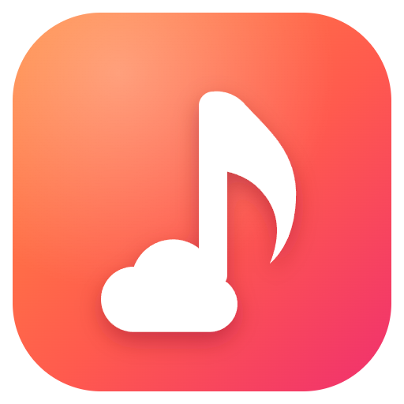

  

<h1 align="center">TeleCloud</h1>

A hi-res music player for Windows that backs up your library to your own Telegram account.

---

## What it does

TeleCloud plays the music files on your computer the way they were recorded, and keeps a private copy of them in Telegram. Telegram gives every account unlimited storage, so your whole collection is safe and can be streamed back to any computer where you sign in.

- **Plays your files as they are.** FLAC, ALAC, WAV, AIFF, APE, WavPack, DSD and the common lossy formats. With an exclusive output device, the sound goes to your DAC untouched (bit-perfect). DSD can go to the DAC as native DSD or DoP.
- **Shows what happens to the sound.** The Signal path panel lists every step from the file to your DAC, and says when something changes it.
- **Backs up to Telegram.** Your music goes into a private channel that only you can see. Files are encrypted before they leave your computer.
- **Streams from the cloud.** Tracks that are only in TeleCloud play straight from Telegram and are kept in a cache for next time.
- **A remote on any device.** A phone, a tablet or another computer on your Wi-Fi opens a page from TeleCloud and controls the music, with nothing to install.
- **Restores on a new computer.** Sign in, restore, and your library comes back with its tags, lyrics and album covers.

## Download and install

1. Download `TeleCloud-Setup-<version>.exe` from the [Releases](https://github.com/MinhHaiDeveloper/telecloud/releases) page.
2. Run it and follow the installer. Everything TeleCloud needs is included.
3. Open TeleCloud from the Start menu or the desktop shortcut.

TeleCloud runs on Windows 10 and Windows 11 (64-bit).

> Windows may show a "Windows protected your PC" screen the first time, because the app is new and not yet widely downloaded. Click **More info** and then **Run anyway**.

## Getting started

### 1. Add your music

Open **Settings > Library**, click **Add folder** and choose where your music lives. You can add several folders. TeleCloud reads your tags and covers and keeps the library up to date when you add, move or delete files.

### 2. Choose how it sounds

In **Settings > Playback**:

- **When an album ends:** another album follows, the artist's next one by year or else the one beside it in Albums. Turn it off to stop at the end of the album.
- **Output device:** pick your DAC or headphones. Devices marked *exclusive* give bit-perfect playback; *System default* shares the sound with other apps.
- **ReplayGain:** evens out the volume between tracks or albums.
- **Crossfade:** blends the end of one track into the next (in shared mode).
- **Channel balance:** turns the left or right side down in steps of 0.5 dB, for uneven ears or headphones.
- **Headphone crossfeed:** blends a little of each side into the other (Light, Medium or Strong), so hard-panned recordings are easier on headphones.
- **MQA:** TeleCloud recognises MQA tracks and shows an **MQA** badge (blue for MQA Studio) with the original rate. *Send to MQA DAC* sends them untouched so an MQA DAC can unfold them; *Play as plain PCM* plays them like any other file. **Find MQA tracks** checks the whole library; otherwise each track is checked the first time it plays.
- **DSD playback:** *Native (ASIO)* sends DSD to your DAC as it is, through its ASIO driver. *DoP* sends it packed in PCM, in exclusive mode. *Convert to PCM* works with every DAC. If one way can't be used, TeleCloud falls back to the next and the signal path says why.
- **Limit output format:** caps the sample rate and bit depth if your device cannot handle very high resolutions.

The EQ, balance, crossfeed and ReplayGain change the sound, so playback is no longer bit-perfect while they are on.

The **Signal path** panel on the right shows exactly what happens to the sound on its way to your device.

**Settings > General > Performance** has two more options:

- **Low memory mode** draws the interface without the graphics card. It uses much less memory; animations may be less smooth. The sound is not affected.
- **Keep running in the tray when closed** hides the window instead of quitting, and the music keeps playing. Quit from the tray icon.

### 3. Shape the sound (optional)

**Settings > Sound** holds everything that changes the sound. Each one is heard as you move it, and none of it is on until you turn it on, so playback stays bit-perfect otherwise.

- **Parametric EQ:** 31 bands. Drag the points on the curve or scroll over them. **AutoEQ** builds a correction from your headphones' measurement and a target sound. Import and export the Squiglink format, undo and redo with `Ctrl+Z` and `Ctrl+Y`. The **live spectrum** under the curve shows the music as it plays, after every filter.
- **Tone:** Warmth (one slider from bright to warm), Bass, Treble, and **Loudness**, which brings back bass and treble as you turn TeleCloud down.
- **Space:** stereo width from mono to wider than the recording, mono, left and right swapped, and polarity.
- **Effects:** Night mode (quiet passages up, loud ones down), Air (shine above 6 kHz) and Tube warmth (soft even harmonics).
- **Room or headphone correction:** load an impulse response (WAV) from REW, Dirac or a headphone tool, or a text file of frequency and gain.
- **Prevent clipping** lowers the level by the biggest boost. If the sound still goes over 0 dBFS, the light in the signal path blinks red.
- **A/B** plays the original at the same loudness, to hear what the settings really do.

### 4. Back up to TeleCloud (optional)

Open **Settings > TeleCloud Sync** and follow the steps:

1. **Get your Telegram app keys.** Go to [my.telegram.org/apps](https://my.telegram.org/apps), sign in with your phone number and create an app (any name works). Copy the **API ID** and **API hash** into TeleCloud. They stay on your computer, protected by Windows.
2. **Sign in.** Enter your phone number and the code Telegram sends you, plus your password if you use two-step verification.
3. **Choose where to store your music.** A private channel is recommended. Saved Messages also works.
4. **Keep encryption on** (recommended) and **save your recovery key** somewhere outside this computer, for example in a password manager. You need it to open your backup after reinstalling Windows or on another computer.
5. Click **Back up now**. You can pause at any time and continue later.

## Using TeleCloud

### Finding your music

Browse by **Library**, **Albums**, **Artists**, **Playlists**, **Favourites** and **Recently played**, or press `Ctrl+K` to search. The **Discover** page shows your recently added albums and what you played last.

### Where a track lives

Each track shows small labels in the **Source** column. The info icon next to "Source" explains them.

| Label | Meaning |
|---|---|
| Local | The file is on this computer. |
| Local + Cloud | On this computer and backed up to TeleCloud. |
| Cloud | Only in TeleCloud. It streams from Telegram when you play it. |
| Cloud + Cached | Only in TeleCloud, but already downloaded, so it plays instantly and offline. |

The **Quality** column shows the format: for example **FLAC 24/96** for hi-res, **FLAC 16/44.1** for CD quality, **DSD64** for DSD, or **MP3 320** for lossy files (the number is the bitrate). MQA tracks also get a badge with the original rate: violet **MQA 88.2**, or blue **MQA Studio 88.2**. The quality filter above the list shows only Hi-Res, DSD, MQA, a bit depth or a sample rate.

Albums can be sorted by title, artist, number of tracks, **Latest added** or **Oldest added**.

### Selecting several tracks

- `Ctrl` + click selects or unselects one track.
- `Shift` + click selects every track between two clicks.
- `Ctrl+A` selects every track in the list, `Esc` clears the selection.

A bar appears at the bottom, where you can play the selection, add it to a playlist, back it up, or remove it from TeleCloud.

### Several storages

You can keep up to five storages, such as "Hi-Res Vault" for your best albums and the default channel for everything else. Add them in **Settings > TeleCloud Sync > Storages**, then use **Back up to...** on a track, an album, a playlist or a selection. Each track is kept in one storage only, so nothing is uploaded twice.

### Removing music from TeleCloud

Use **Remove from TeleCloud** in a track's menu, in an album or playlist menu, or on a selection. Only those tracks are deleted from Telegram; the rest of the storage stays.

- If the file is still on your computer, it simply becomes a Local track again.
- If the track only existed in TeleCloud, it leaves your library for good. TeleCloud asks before doing this.

### Saving a track to your computer

Choose **Download** in a track's menu, or **Download album** in an album's menu, to keep a copy on your computer. Each track goes into a folder named after its album, inside the download folder set in **Settings > Downloads**.

For a track whose file is on this computer, **Open file location** shows it in File Explorer.

### Artist pictures

Open an artist and click **Artist picture** to choose one from the online sources (Last.fm, Deezer, TheAudioDB, Apple Music, MusicBrainz) or upload your own. The **YouTube** tab looks at YouTube channels, and **Find on VGMdb** opens VGMdb's search in your browser. The picture is saved into the tags of that artist's own tracks, so other players see it too.

Animated GIFs move on the artist's page. Tags get a still frame, and the GIF itself goes into your TeleCloud backup, so it comes back on another computer.

### Discord status

In **Settings > General > Discord**, TeleCloud can show what you are listening to on your Discord status, with the album cover and a small picture of the artist. While nothing is loaded, it shows the last track you played. It needs the Discord desktop app on the same computer.

### Remote control from a phone or another computer

In **Settings > Remote**, turn on **Let other devices control TeleCloud** and scan the QR code with a phone, or open the address in any browser on the same network. The device stays paired after that. From it you can:

- Play, pause, skip, seek, change the volume, shuffle and repeat.
- See and change Up next: play a track from it, move it, remove it.
- Browse and search your albums, artists, playlists, favourites and recently played, and play them, play them next or add them to the queue.
- Choose the output device and turn the equalizer on or off, and see the signal path in short.
- Read the lyrics as they are sung (tap the lyrics button on Playing); tap a line to go there.

Tracks that are only in TeleCloud show a small cloud and play just as they would on the computer: a cached one at once, any other streams from Telegram, so the computer needs to be signed in to TeleCloud. If one can't play, the remote says why. Artists show the picture you chose for them. When you edit tags, change a cover or an artist picture on the computer, remotes show it straight away, even on the page they have open. On a Galaxy Z Fold, the remote has layouts of its own: open, two pages meet at the crease (now playing in the album's colours on the left, the queue, library and output on the right); half folded in Flex Mode, the cover or the lyrics fill the top half and the controls the bottom; on the tall cover screen, the tabs sit at the bottom under your thumb. Names cut off with "…" show in full when you hover them, or press and hold them on a phone.

**Keep this computer awake while music plays** stops Windows from sleeping in the middle of an album. To wake a sleeping computer from a phone, open **Wake this computer from a phone** in the same place: it lists the steps and the MAC address a Wake-on-LAN app needs.

The sound still comes from your computer. Each paired device can be set to **View only**, and **New key** signs every device out. The address changes each time TeleCloud starts, so scan again then. If a device can't connect, allow TeleCloud for private networks when Windows asks, and make sure your Wi-Fi is set to Private, not Public.

### Restoring on another computer

Install TeleCloud, sign in with the same Telegram account, enter your recovery key under **Encryption**, and choose **Restore**. Your tracks appear with their tags, lyrics and covers, ready to stream or download.

## Keeping your backup safe

The **Do's & don'ts** button in **Settings > TeleCloud Sync** has the full list. The most important points:

**Do**

- Leave TeleCloud open until the backup has finished.
- Press **Pause** before quitting in the middle of a backup.
- Keep your recovery key outside this computer.
- Remove or move tracks from inside TeleCloud.

**Don't**

- Delete, edit or forward TeleCloud files in Telegram yourself.
- Delete the `library.tcm` file in your storage chats. It is the index other computers restore from.
- Leave or delete a storage channel in Telegram. Remove it in TeleCloud's settings instead.
- Restart the app when it says it is waiting. That is Telegram's speed limit, and TeleCloud continues by itself.

## Keyboard shortcuts

| Action | Shortcut |
|---|---|
| Play / pause | `Space` |
| Next track | `Right arrow` |
| Previous track | `Left arrow` |
| Volume up / down | `Up arrow` / `Down arrow` |
| Seek forward / back | `Ctrl+Right` / `Ctrl+Left` |
| Mute | `M` |
| Search | `Ctrl+K` |
| Select all tracks | `Ctrl+A` |

You can change the playback shortcuts in **Settings > Keyboard**.

## Questions

**Is my music private?**
Yes. It is stored in your own Telegram account, in a channel only you can see. With encryption on, the files cannot be played by anyone who does not have your recovery key, Telegram included.

**How much can I store?**
Telegram does not limit the total size. Single files can be up to 2 GB, which covers almost any album track.

**Does streaming change the sound?**
No. The exact file you uploaded is streamed back, and TeleCloud checks it against the original before saving it to the cache.

**How much disk space does the cache use?**
5 GB by default. You can change it or clear it in **Settings > TeleCloud Sync > Cache**. The oldest tracks are removed first when it is full.

**I lost my recovery key.**
Your backup can still be used on the computer where you made it. You can see the key there under **Settings > TeleCloud Sync > Encryption**. Without the key, encrypted files cannot be opened anywhere else.

## Feedback

TeleCloud is in beta and made by a single developer. If something does not work as expected, or you have an idea, please open an issue on the [Issues](https://github.com/MinhHaiDeveloper/telecloud/issues) page.

TeleCloud is not affiliated with Telegram.

## License

TeleCloud is free software under the [GNU General Public License v3.0](LICENSE).
