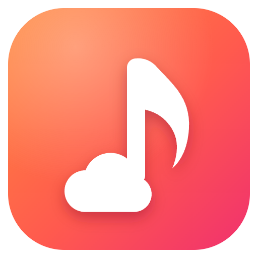

  

<h1 align="center">TeleCloud</h1>

  <b>Your music, bit-perfect. Your backup, encrypted, wherever you want it.</b> 
  A hi-res music player for Windows, with a private backup to your own Telegram or to a folder you pick. 
  No server. No subscription. No lock-in.

  
  
  

  
  
  
  

  

---

## What it does

TeleCloud plays the music files on your computer the way they were recorded, tells you whether a file is what it says it is, and keeps an encrypted copy of your library where you choose: your own Telegram, a second drive, a NAS, or the folder your OneDrive or Google Drive app keeps in step. Nothing passes through a server of ours, because there is none.

- **Plays your files as they are.** FLAC, ALAC, WAV, AIFF, APE, WavPack, DSD and the common lossy formats. With an exclusive output device, the sound goes to your DAC untouched (bit-perfect). DSD can go to the DAC as native DSD or DoP.
- **Shows what happens to the sound.** The Signal path panel lists every step from the file to your DAC, and says when something changes it.
- **Checks your files.** Quality check finds the "hi-res" files that are really MP3s, upsampled CDs or padded bits, and measures the master: loudness, true peak, dynamic range. It can check the whole library in the background and mark what is worth a look.
- **Shapes the sound, if you want.** A 31-band EQ with AutoEQ, including making one headphone sound like another, room correction from an impulse response, and an A/B switch at matched loudness.
- **Lyrics word by word.** From NetEase, QQ Music and Kugou, or timed on your computer by Cadence when a file only has lines.
- **Backs up, encrypted.** To a private Telegram channel or to a folder. Files are encrypted before they leave your computer, and every one is checked when it comes back.
- **Streams and restores.** Tracks that are only in your backup play with seeking and are cached for next time. On a new computer your library comes back with its tags, lyrics and covers.
- **A remote on any device.** A phone, a tablet or another computer on your Wi-Fi opens a page from TeleCloud and controls the music, with nothing to install.
- **Your data is yours.** Export your listening history, playlists and favourites to plain files (JSON, M3U8, CSV, ListenBrainz) at any time.

<table>
  <tr>
    <td width="50%"></td>
    <td width="50%"></td>
  </tr>
  <tr>
    <td align="center"><b>Quality check</b>: is the file what it says it is?</td>
    <td align="center"><b>Mastering</b>: how loud, how compressed, how much headroom</td>
  </tr>
  <tr>
    <td width="50%"></td>
    <td width="50%"></td>
  </tr>
  <tr>
    <td align="center"><b>Word by word</b>, in Now Playing, the floating lyrics and the remote</td>
    <td align="center"><b>The remote</b>, from a QR code, nothing to install</td>
  </tr>
</table>

## Download and install

1. Download `TeleCloud-Setup-<version>.exe` from the [Releases](https://github.com/MinhHaiDeveloper/telecloud/releases) page. Betas are marked Pre-release and named `TeleCloud-Beta-Setup-<version>.exe`; a beta installs as TeleCloud Beta in place of TeleCloud (and the other way round), with the same library.
2. Run it and follow the installer. Everything TeleCloud needs is included.
3. Open TeleCloud from the Start menu or the desktop shortcut.

TeleCloud runs on Windows 10 and Windows 11 (64-bit).

> Windows may show a "Windows protected your PC" screen the first time, because the app is new and not yet widely downloaded. Click **More info** and then **Run anyway**.

## Getting started

### 1. Add your music

Open **Settings > Library**, click **Add folder** and choose where your music lives. You can add several folders. TeleCloud reads your tags and covers and keeps the library up to date when you add, move or delete files.

### 2. Choose how it sounds

In **Settings > Playback**:

- **Let other apps use the DAC while paused:** in WASAPI Exclusive and native DSD, the DAC is free a few seconds after a pause; Play takes it back from the same moment.
- **Fade on play and pause:** a short fade, never while playback is bit-perfect.
- **When an album ends:** another album follows, the artist's next one by year or else the one beside it in Albums. Turn it off to stop at the end of the album.
- **Output device:** pick your DAC or headphones. Devices marked *exclusive* give bit-perfect playback; *System default* shares the sound with other apps.
- **ReplayGain:** evens out the volume between tracks or albums.
- **Crossfade:** blends the end of one track into the next (in shared mode).
- **Channel balance:** turns the left or right side down in steps of 0.5 dB, for uneven ears or headphones.
- **Headphone crossfeed:** blends a little of each side into the other (Light, Medium or Strong), so hard-panned recordings are easier on headphones.
- **MQA:** TeleCloud recognises MQA tracks and shows an **MQA** badge (blue for MQA Studio) with the original rate. *Send to MQA DAC* sends them untouched so an MQA DAC can unfold them; *Play as plain PCM* plays them like any other file. **Find MQA tracks** checks the whole library; otherwise each track is checked the first time it plays.
- **DSD playback:** *Native (ASIO)* sends DSD to your DAC as it is, through its ASIO driver. *DoP* sends it packed in PCM, in exclusive mode. *Convert to PCM* works with every DAC. If one way can't be used, TeleCloud falls back to the next and the signal path says why.
- **Limit output format:** caps the sample rate and bit depth if your device cannot handle very high resolutions.
- **Skip silence:** silences of 2 seconds and more, inside a track and between tracks, shrink to half a second; for live albums, podcasts and hidden tracks. Not bit-perfect while on, and the seek bar and synced lyrics run a little behind after a skipped silence.
- **Exclusive mode buffer:** how much music the DAC gets at a time in WASAPI Exclusive: the device's default, its minimum, or 20 to 200 ms. If your DAC clicks or skips now and then, try another size; some prefer a larger one, some USB DACs a smaller one. It stays bit-perfect.

The EQ, balance, crossfeed and ReplayGain change the sound, so playback is no longer bit-perfect while they are on.

The **Signal path** panel on the right shows exactly what happens to the sound on its way to your device.

**Settings > General > Performance** has two more options:

- **Low memory mode** draws the interface without the graphics card. It uses much less memory; animations may be less smooth. The sound is not affected.
- **Keep running in the tray when closed** hides the window instead of quitting, and the music keeps playing. Quit from the tray icon.

### Controls outside the window

- **Windows media controls:** the box by the volume keys and the lock screen show what plays, with its cover, and control it. The keyboard's media keys work while TeleCloud is in the background.
- **Taskbar and tray:** Previous, Play/Pause and Next on the taskbar thumbnail and in the tray menu.
- **Default music player:** choose TeleCloud in Explorer's "Open with" (and "Always") for FLAC, MP3, WAV, DSF and other music files. A file opened from Explorer plays at once in Now Playing.
- **Word-by-word lyrics:** lyrics with a time for each word (Enhanced LRC, TTML) light up as they are sung. With **Settings > Lyrics > Word by word when available** on, the lyrics search asks NetEase, QQ Music and Kugou for word-timed lyrics and prefers them; songs without them keep line-synced lyrics.
- **Waveform seek bar:** the track's loudness over time behind the seek bar (Settings > Appearance).
- **Floating lyrics:** a small window over everything with the line being sung; lock it and clicks go through. From the lyrics card, the tray or Settings > Appearance.
- **Sleep timer:** the moon in the player bar (also in the tray and the remote): minutes, the end of this track or album, or after a number of tracks. The last 10 seconds fade out.

### How it looks

**Settings > Appearance** has the themes, and more:

- **Cover change:** when the album changes, the new cover floods in like liquid over the last one. Behind Now Playing, the cover's colours slowly drift, swirl with the change, then settle.
- **Reduce motion:** buttons, pages and covers change at once, nothing pours or swirls. It is also on when Windows asks for less motion.
- **Side panel and Signal path card:** put the panel away (`Ctrl+J`), and show the Signal path in full, compact or not at all.

### 3. Shape the sound (optional)

**Settings > Sound** holds everything that changes the sound. Each one is heard as you move it, and none of it is on until you turn it on, so playback stays bit-perfect otherwise.

- **Parametric EQ:** 31 bands. Drag the points on the curve or scroll over them. **AutoEQ** builds a correction from your headphones' measurement and a target sound: a curve such as Harman, or **another headphone**, to make, say, a HiFiMAN HE400se sound like a Sennheiser HE 1. Either headphone can come from a file such as a Squiglink export (pick its left and right files together and they are averaged). Import and export the Squiglink format, undo and redo with `Ctrl+Z` and `Ctrl+Y`. The **live spectrum** under the curve shows the music as it plays, after every filter.
- **Tone:** Warmth (one slider from bright to warm), Bass, Treble, and **Loudness**, which brings back bass and treble as you turn TeleCloud down.
- **Space:** stereo width from mono to wider than the recording, mono, left and right swapped, and polarity.
- **Effects:** Night mode (quiet passages up, loud ones down), Air (shine above 6 kHz) and Tube warmth (soft even harmonics).
- **Room or headphone correction:** load an impulse response (WAV) from REW, Dirac or a headphone tool, or a text file of frequency and gain. A WAV can play as its frequency response only, or in full (timing, phase and a response for each channel), by convolution.
- **Prevent clipping** lowers the level by the biggest boost. If the sound still goes over 0 dBFS, the light in the signal path blinks red.
- **A/B** plays the original at the same loudness, to hear what the settings really do.

### 4. Back up (optional)

Open **Settings > TeleCloud Sync**. You can back up to a folder, to Telegram, or to both (up to five storages), and move tracks between them later.

**To a folder** (no account needed): click **Or back up to a folder** (or, with Telegram set up, add **A folder** as a storage) and pick a second drive, a share on your NAS, or the folder your OneDrive, Google Drive or Dropbox app keeps in step. TeleCloud keeps its files in a `TeleCloud` folder inside it. **Save your recovery key** when it is shown, then click **Back up now**.

**To Telegram**, follow the steps:

1. **Get your Telegram app keys.** Go to [my.telegram.org/apps](https://my.telegram.org/apps), sign in with your phone number and create an app (any name works). Copy the **API ID** and **API hash** into TeleCloud. They stay on your computer, protected by Windows.
2. **Sign in.** Enter your phone number and the code Telegram sends you, plus your password if you use two-step verification.
3. **Choose where to store your music.** A private channel is recommended. Saved Messages also works.
4. **Keep encryption on** (recommended) and **save your recovery key** somewhere outside this computer, for example in a password manager. You need it to open your backup after reinstalling Windows or on another computer.
5. Click **Back up now**. You can pause at any time and continue later.

If Telegram ever signs TeleCloud out (a sign-in left unused for the time set in Telegram > Settings > Devices, or ended from another device), TeleCloud says so in plain words, keeps your backups and settings, and signs in again with just a code. The TeleCloud page shows how long Telegram keeps an unused sign-in; opening TeleCloud now and then keeps it signed in.

## Using TeleCloud

### Finding your music

Browse by **Library**, **Albums**, **Artists**, **Folders**, **Playlists**, **Favourites** and **Recently played**, or press `Ctrl+K` to search. **Folders** shows your music the way it sits on disk; play or shuffle a whole folder. The **Discover** page shows your recently added albums, what you played last, **Most played** this week, month or year, and **On this day**: what you were playing around this date in earlier years. The **Dashboard** can show a range of dates you pick.

### Playlists and the queue

- **Smart playlists:** a playlist made of rules (artist, genre, year, quality, format, MQA, plays, last played, date added, favourite, where it is), matching all or any, with an order and a limit. It keeps itself up to date.
- **Import and export** playlists as `.m3u8` or `.m3u`. Tracks that are not in your library are listed, not dropped without a word.
- **Play next** and **Add to queue** are in every track menu and the selection bar. Tracks added with Play next one after another keep their order, and a track can be played 2, 3 or 5 times in a row.

### Lyrics

Lyrics show in the side panel, Now Playing, the floating lyrics and the remote. TeleCloud reads them from the tags or a `.lrc` file next to the track, and can look online when a track has none (**Settings > Lyrics**): LRCLIB, NetEase Cloud Music, QQ Music and Kugou, plus Genius and Musixmatch if you turn them on. **Lyrics** in a track's menu searches every source, lets you pick and edit a result, sync it line by line as the music plays, and save it into the tags, a `.lrc` file or both.

### Quality check

**Quality check** in a track's menu answers two questions, in two tabs:

- **Fidelity:** is the file what it says it is? A verdict with how sure it is (genuine, likely transcoded from a lossy file, upsampled, padded to more bits than it uses, or Inconclusive when the clues disagree), each clue on its own line (open it for why it matters), the spectrogram and the average spectrum.
- **Mastering:** how the song was mastered, whatever the file: loudness and loudness range (EBU R128), true peak and the overs between samples, dynamic range for each side, clipping, average level and stereo correlation. One line sums them up; there is no score.

**Copy as text** copies both tabs to paste in a forum or a chat, without where the file is. It ends with "Checked with TeleCloud" and the website; **Settings > Library > Sign copied results** leaves that out.

To check the whole library, turn on **Settings > Library > Check track quality in the background**. It works one track at a time at the lowest priority, waits while the computer is on battery, busy or playing bit-perfect, and checks new tracks after they are added. Tracks worth a look get a dot on their quality tag (red for a likely lossy source, amber for an upsample or padded bits); click it for the details, or pick **Worth a look** in the quality filter.

### Where a track lives

Each track shows small labels in the **Source** column. The info icon next to "Source" explains them.

| Label | Meaning |
|---|---|
| Local | The file is on this computer. |
| Local + Cloud | On this computer and backed up to TeleCloud. |
| Cloud | Only in TeleCloud. It streams from Telegram when you play it. |
| Cloud + Cached | Only in TeleCloud, but already downloaded, so it plays instantly and offline. |

The **Quality** column shows the format: for example **FLAC 24/96** for hi-res, **FLAC 16/44.1** for CD quality, **DSD64** for DSD, or **MP3 320** for lossy files (the number is the bitrate). MQA tracks also get a badge with the original rate: violet **MQA 88.2**, or blue **MQA Studio 88.2**. The quality filter above the list shows only Hi-Res, DSD, MQA, a bit depth or a sample rate.

Albums can be sorted by title, artist, number of tracks, **Latest added** or **Oldest added**.

### Selecting several tracks

- `Ctrl` + click selects or unselects one track.
- `Shift` + click selects every track between two clicks.
- `Ctrl+A` selects every track in the list, `Esc` clears the selection.

A bar appears at the bottom, where you can play the selection, add it to a playlist, download it, back it up, or remove it from TeleCloud.

### Several storages

You can keep up to five storages, such as "Hi-Res Vault" for your best albums and the default channel for everything else. Add them in **Settings > TeleCloud Sync > Storages**, then use **Back up to...** on a track, an album, a playlist or a selection. Each track is kept in one storage only, so nothing is uploaded twice.

### Backing up by itself, and when

In **Settings > TeleCloud Sync**:

- **Back up new tracks** (off until you turn it on): tracks that appear in your music folders are backed up by themselves, into the storage their album is already in (or, for a new album, the storage its folder's tracks are in; else the one you pick under **New albums go to**). Tracks already backed up are always backed up again when their file changes, as before.
- **Upload schedule** (off until you turn it on): backups run only between two times you choose, to the minute, for example from 01:30 to 06:45, also past midnight. It applies to everything, or only to the folders and albums you choose; other tracks upload at once. Outside the window, **Back up now anyway** starts the waiting ones.

### Removing music from TeleCloud

Use **Remove from TeleCloud** in a track's menu, in an album or playlist menu, or on a selection. Only those tracks are deleted from Telegram; the rest of the storage stays.

- If the file is still on your computer, it simply becomes a Local track again.
- If the track only existed in TeleCloud, it leaves your library for good. TeleCloud asks before doing this.

### Saving a track to your computer

Choose **Download** in a track's menu, **Download album** in an album's menu, or the download button on a selection, to keep a copy on your computer. Each track goes into a folder named after its album, inside the download folder set in **Settings > Downloads**.

To keep an album or a playlist playable without the internet, but in TeleCloud's cache rather than your folders, choose **Keep offline** in its menu. Its cloud tracks download in the background and stay in the cache, also when the cache is full or cleared; a track added later is kept too. **Settings > TeleCloud Sync > Cache** lists what is kept, with **Stop**.

For a track whose file is on this computer, **Open file location** shows it in File Explorer.

### Your data

**Settings > Library > Your data** exports your listening history, playlists, favourites and a list of the library to one `.zip` of plain files: JSON, M3U8 for other players, CSV, and the history in the ListenBrainz format too, with your settings if you like. Music files, keys and sign-ins are never in it. **Import** on another computer, or the same one, adds to what is there and replaces nothing; a track that computer does not have yet joins its playlists by itself when it shows up.

### Artist pictures

Open an artist and click **Artist picture** to choose one from the online sources (Last.fm, Deezer, TheAudioDB, Apple Music, QQ Music, MusicBrainz) or upload your own. The **YouTube** tab looks at YouTube channels, and **Find on VGMdb** opens VGMdb's search in your browser. The picture is saved into the tags of that artist's own tracks, so other players see it too.

The artist page also shows a short biography: Last.fm's, in English, when it says enough, with tags and similar artists; QQ Music's, in Chinese, where Last.fm has little or nothing (often for Chinese and other Asian artists). When both have one, a **Last.fm | QQ Music** switch shows the other.

Animated GIFs move on the artist's page. Tags get a still frame, and the GIF itself goes into your TeleCloud backup, so it comes back on another computer.

### Album covers

When a track has no cover, TeleCloud can look online (**Settings > General > Album covers**): Apple Music, Deezer, QQ Music (best for Chinese and other Asian albums), MusicBrainz's Cover Art Archive and Last.fm. **Album cover…** in an album's menu lets you pick one, or a picture of your own, and saves it as `cover.jpg`, into the tags, or both.

### Scrobbling: Last.fm and ListenBrainz

In **Settings > General**, connect **Last.fm** (sign in on its site) or **ListenBrainz** (paste your user token from [listenbrainz.org/settings](https://listenbrainz.org/settings/)), or both. A play counts once you have heard half the track or 4 minutes; what you play now shows on your profile. Plays made offline wait and are sent later. ListenBrainz gets each track's MusicBrainz IDs when TeleCloud is sure of them, from the tags Picard writes or one search per track. Each one can be paused or disconnected on its own; the token stays on this computer, encrypted.

### Discord status

In **Settings > General > Discord**, TeleCloud can show what you are listening to on your Discord status, with the album cover and a small picture of the artist. While nothing is loaded, it shows the last track you played. It needs the Discord desktop app on the same computer.

### Remote control from a phone or another computer

In **Settings > Remote**, turn on **Let other devices control TeleCloud** and scan the QR code with a phone, or open the address in any browser on the same network. The device stays paired after that. From it you can:

- Play, pause, skip, seek, change the volume, shuffle and repeat.
- See and change Up next: play a track from it, move it, remove it.
- Browse and search your albums, artists, playlists, favourites and recently played, and play them, play them next or add them to the queue.
- Choose the output device and turn the equalizer on or off, and see the signal path in short.
- Read the lyrics as they are sung (tap the lyrics button on Playing); tap a line to go there.

Tracks that are only in TeleCloud show a small cloud and play just as they would on the computer: a cached one at once, any other streams from Telegram, so the computer needs to be signed in to TeleCloud. If one can't play, the remote says why. Artists show the picture you chose for them. When you edit tags, change a cover or an artist picture on the computer, remotes show it straight away, even on the page they have open. On a Galaxy Z Fold, the remote has layouts of its own: open, two pages meet at the crease (now playing in the album's colours on the left, the queue, library and output on the right); half folded in Flex Mode, the cover or the lyrics fill the top half and the controls the bottom; on the tall cover screen, the tabs sit at the bottom under your thumb. Names cut off with "…" show in full when you hover them, or press and hold them on a phone.

**Keep this computer awake while music plays** stops Windows from sleeping in the middle of an album. To wake a sleeping computer from a phone, open **Wake this computer from a phone** in the same place: it lists the steps and the MAC address a Wake-on-LAN app needs.

The sound still comes from your computer. Each paired device can be set to **View only**, and **New key** signs every device out. The address changes each time TeleCloud starts, so scan again then. If a device can't connect, allow TeleCloud for private networks when Windows asks, and make sure your Wi-Fi is set to Private, not Public.

### Restoring on another computer

Install TeleCloud, enter your recovery key under **Encryption**, then add the same storage: sign in with the same Telegram account, or pick the same folder (on that computer's NAS share or synced cloud folder). Choose **Restore**, and your tracks appear with their tags, lyrics and covers, ready to stream or download.

## Keeping your backup safe

The **Do's & don'ts** button in **Settings > TeleCloud Sync** has the full list. The most important points:

**Do**

- Leave TeleCloud open until the backup has finished.
- Press **Pause** before quitting in the middle of a backup.
- Keep your recovery key outside this computer.
- Remove or move tracks from inside TeleCloud.

**Don't**

- Delete, edit or forward TeleCloud files in Telegram yourself.
- Delete the `library.tcm` file in your storage chats. It is the index other computers restore from.
- Leave or delete a storage channel in Telegram. Remove it in TeleCloud's settings instead.
- Restart the app when it says it is waiting. That is Telegram's speed limit, and TeleCloud continues by itself.

## Keyboard shortcuts

| Action | Shortcut |
|---|---|
| Play / pause | `Space` |
| Next track | `Right arrow` |
| Previous track | `Left arrow` |
| Volume up / down | `Up arrow` / `Down arrow` |
| Seek forward / back | `Ctrl+Right` / `Ctrl+Left` |
| Mute | `M` |
| Search | `Ctrl+K` |
| Select all tracks | `Ctrl+A` |

You can change the playback shortcuts in **Settings > Keyboard**.

## Questions

**Is my music private?**
Yes. It is stored in your own Telegram account, in a channel only you can see, or in a folder you chose. With encryption on, the files cannot be played by anyone who does not have your recovery key, Telegram or your cloud drive included. How it works, and what it does not cover, is in [SECURITY.md](SECURITY.md).

**How much can I store?**
In a folder, as much as the drive holds. Telegram sets no total size; single files can be up to 2 GB, which covers almost any album track.

**Does streaming change the sound?**
No. The exact file you uploaded is streamed back, and TeleCloud checks it against the original before saving it to the cache.

**How much disk space does the cache use?**
5 GB by default. You can change it or clear it in **Settings > TeleCloud Sync > Cache**. The oldest tracks are removed first when it is full.

**I lost my recovery key.**
Your backup can still be used on the computer where you made it. You can see the key there under **Settings > TeleCloud Sync > Encryption**. Without the key, encrypted files cannot be opened anywhere else.

## Feedback

TeleCloud is in beta and made by a single developer. If something does not work as expected, or you have an idea, please open an issue on the [Issues](https://github.com/MinhHaiDeveloper/telecloud/issues) page. To help with code or translations, see [CONTRIBUTING.md](CONTRIBUTING.md). Security problems go privately, as [SECURITY.md](SECURITY.md) explains.

TeleCloud is not affiliated with Telegram.

## License

TeleCloud is free software under the [GNU General Public License v3.0](LICENSE).
