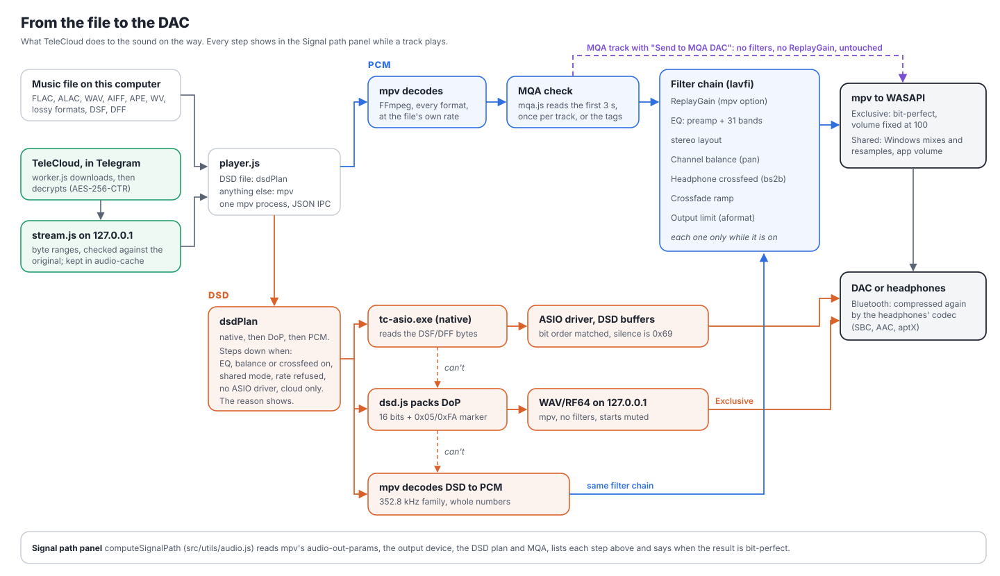

# TeleCloud: technical documentation

For what the app does and how to use it, see the [main README](../README.md). This file is for people working on the code.

TeleCloud is a hi-res music player for Windows, built with Electron and React. mpv plays the audio, and the user's own Telegram account stores the backup. No server belongs to the project.

## Tech stack

| Part | Used for |
|---|---|
| Electron | Desktop shell, main process, background processes |
| React and Vite | Interface in `src/` |
| mpv (`mpv.exe`, included in the repo) | Playback, EQ filters, spectrum decoding |
| `better-sqlite3` | Library, play history and TeleCloud tables |
| `music-metadata` | Reading tags and cover art |
| `node-taglib-sharp` | Writing tags and cover art |
| `telegram` (GramJS) | Telegram access, in its own process |
| `electron-updater` | Updates from GitHub Releases |
| `electron-store` | Encrypted TeleCloud credentials and options |
| `tc-asio.exe` (`native/asio`, C++) | Native DSD through the DAC's ASIO driver |
| `tc-media.exe` (`native/media`, C++/WinRT) | Windows media controls and the keyboard's media keys |
| WebGL (in the page) | The liquid cover change and the Now Playing backdrop |
| `onnxruntime-node` (DirectML) | The word-timing models; only its Windows x64 files go in the installer, unpacked from the asar |
| `pinyin-pro` | Chinese lyrics read as pinyin for word timing |

## Getting started

You need Node.js (currently developed on v24) and Windows 10 or 11, 64-bit.

```bash
git clone https://github.com/MinhHaiDeveloper/telecloud.git
cd telecloud
npm install
npm run dev
```

`npm run dev` starts Vite on port 3000 and opens Electron on it.

Every user enters their own Telegram app keys in the app, so no keys are needed to build it. Last.fm is the exception: it reads the app's key from `electron/lastfm-key.json`, or from `LASTFM_API_KEY` and `LASTFM_API_SECRET`. That file is not in git. Without it the app works, but Last.fm stays unavailable.

## Project layout

```
electron/            main process
  telecloud/         Telegram backup, streaming, restore
src/
  components/        React components
  hooks/             useEq, useSound, useCoverAccent, useRemembered, useSlidingIndicator
  utils/             logic with no interface
  remote/            the Remote page (its own Vite entry, remote.html)
  styles/            tokens.css, app.css, components.css
native/asio          tc-asio.exe (native DSD)
native/media         tc-media.exe (Windows media controls)
scripts/release.js   build one channel into beta/ or release/
```

### Main process (`electron/`)

| File | Responsibility |
|---|---|
| `main.js` | Startup, window, `media://` protocol, folder watching |
| `preload.js` | The only bridge to the page, with allowlists of channels |
| `paths.js` | Decides which paths may be read, played, written or deleted |
| `database.js` | `music_files` table, migrations |
| `music.js` | Scanning, syncing with the database, JSON stores |
| `tags.js`, `tagPool.js`, `tagWorker.js` | Reading tags on worker threads |
| `tagEdit.js` | Writing tags from Edit info |
| `inferTags.js` | Filling in missing tags from the file name and folders |
| `fileWrite.js` | Plain-language write errors, writing to read-only files on request |
| `player.js` | mpv over JSON IPC, filter chain, crossfade, output devices, DSD plan, exclusive buffer, releasing the DAC while paused |
| `soundChain.js` | Settings > Sound (tone, space, effects, A/B, clip meter) as mpv filters; pure functions |
| `soundCorrection.js` | Room or headphone correction from a WAV impulse response or a frequency/gain text file |
| `liveSpectrum.js` | The EQ page's live spectrum and Now Playing's VU meters: a second, silent mpv through the same filters (mono FFT, or stereo RMS and peak) |
| `waveform.js` | The waveform seek bar: a track's loudness, worked out once with mpv and kept |
| `dsd.js` | Reading DSF/DFF and packing DoP |
| `asio.js` | Runs `tc-asio.exe` for native DSD |
| `mqa.js` | Finding MQA in the audio and the tags |
| `tagFile.js` | Opening tags, including DSF (its ID3v2 tag at the end) |
| `artistImages.js` | Artist picture sources, saving, GIFs |
| `tray.js` | Close to the tray, one copy of the app, the tray menu's controls |
| `media.js` | Runs `tc-media.exe`: Windows media controls, media keys, the taskbar thumbnail buttons |
| `openFiles.js` | "Open with TeleCloud" and the default player: files from the command line play at once |
| `mainWindow.js` | Which window is the app's own (not the floating lyrics) |
| `httpError.js` | What a failed answer from an online source means, in short words |
| `covers.js` | Finding and caching cover art |
| `coverSearch.js` | Online cover sources, saving covers |
| `lyrics.js` | Lyrics sources, word-by-word lyrics (YRC, KRC, QRC to Enhanced LRC), saving |
| `wordTiming.js` | Word timing ("TeleCloud Cadence"): runs `cadence/` in a utility process, one song at a time |
| `cadenceModels.js` | Cadence's model packs: download from the telecloud-models release (resumable, SHA-256 checked), delete |
| `cadence/` | The word-timing engine: Demucs voice separation, wav2vec2 CTC alignment, STFT and resampling in JS |
| `qrc.js` | Decrypting QQ Music's QRC lyrics (QQ's own variant of Triple DES, then zlib) |
| `floatingLyrics.js` | The floating lyrics window, always on top; locked, clicks go through |
| `m3u.js` | Playlist import and export as .m3u / .m3u8 |
| `stats.js` | Play history, play counts, Dashboard data |
| `lastfm.js` | Scrobbling and artist biographies |
| `artistBio.js` | Artist biographies: Last.fm and QQ Music, and which one to show first |
| `listenbrainz.js` | ListenBrainz listens from the play history, MusicBrainz IDs for each track |
| `discord.js` | Discord status over its local pipe |
| `remote.js` | TeleCloud Remote: the local web server other devices control the app through |
| `autoeq.js` | Headphone measurements and target curves |
| `spectrum.js`, `spectrumCore.js` | Spectrogram and lossless check |
| `watcher.js` | Native folder watching, followed by a normal refresh |
| `updater.js` | Update checks and installation |
| `logger.js`, `logExport.js` | Log files and the log export |
| `credentialManager.js` | Encrypting Telegram credentials with Windows DPAPI |

### TeleCloud (`electron/telecloud/`)

| File | Responsibility |
|---|---|
| `service.js` | Sign-in, backup queue, cache, restore, storages, index |
| `store.js` | TeleCloud tables |
| `workerClient.js` | Starts the worker and passes calls to it |
| `worker.js` | Everything that talks to Telegram, in a separate process |
| `stream.js` | Local HTTP server that streams cloud tracks to mpv |
| `crypto.js` | Client-side encryption |
| `caption.js` | The text stored with each message in Telegram |

### Interface (`src/`)

`App.jsx` holds the shared state: library, playback, queue, navigation. Views get what they need as props or through the `SongActions` context in `components/songActions.js`.

| File | Responsibility |
|---|---|
| `utils/albums.js` | Which tracks form an album and who owns it. Every page uses it |
| `utils/audio.js` | Formatting, quality labels, signal path, duplicates, cover addresses |
| `utils/autoEqMath.js` | Filter responses, AutoEQ, Squiglink and Audacity formats |
| `utils/appearance.js` | Full-screen look, saved in `localStorage` |
| `utils/whatsNew.js` | Release notes shown in the app |
| `utils/lyrics.js` | Reading lyrics: plain, LRC, Enhanced LRC (a time per word) and TTML into one line format |
| `utils/liquid.js` | The liquid cover change and the fluid backdrop: WebGL shaders, pooled canvases, one clock per change |
| `utils/smartPlaylist.js` | Smart playlist rules, worked out from the library each time |
| `hooks/useSound.js` | Settings > Sound in the page, sent to `soundChain.js` |
| `utils/badges.js` | Text for the Source, Quality and Plays help |
| `components/ui.jsx` | Shared controls, dialogs, `useDetailScroll` |
| `i18n.js` | `t()` for every text in the interface, the language picked, plural forms. Catalog in `locales/` |
| `remote/` | The Remote page other devices open (`remote.html` entry), and `hostQuery.js`, which answers its library questions inside the app |

## How it works

### Security boundary

The page runs with `contextIsolation`, `sandbox` and no `nodeIntegration`. It reaches the main process only through `window.ipcRenderer` in `preload.js`.

- A new IPC channel must be added to `INVOKE_CHANNELS` or `EVENT_CHANNELS`, otherwise the call is refused.
- Listen with `ipcOn(window.ipcRenderer, channel, fn)` and stop with `ipcOff(...)` from `src/utils/ipc.js`, never `window.ipcRenderer.removeListener`: the bridge hands the main process a new copy of `fn` on every call, so `removeListener` finds nothing and the listener stays. `on()` returns its own remover, which `ipcOn` keeps.
- Any handler that takes a path from the page must check it with `paths.js`.

### Library

`syncLibrary` in `music.js` compares the music folders with the database by path, size and modified time. Only new or changed files are read, on worker threads, and the results reach the page in batches.

A backed-up track whose file disappears becomes cloud-only. Tracks in a folder that can't be read, such as an unplugged drive, are kept. A backed-up file whose bytes change is uploaded again.

Older libraries gain `album_artist` from `backfillAlbumArtists`, which runs once in the background and changes only that column.

### Albums and artists

`Various Artists` and `Unknown Artist` are labels, not artists (`artistLabel`). They are pinned first on the Artists page, hold the albums nobody is named on, show a grid of those covers, and never get a search or a bio.

`albumIndex` in `utils/albums.js` groups tracks like this:

- The same name and overlapping album artists make one album, however many guests the tracks have.
- The same name with different album artists makes separate albums.
- Without an album artist tag, tracks in one folder stay together, and across folders they join when the main artist matches.

An album without the tag belongs to an artist who is on more than half of its tracks. Otherwise it shows as Various Artists.

`inferTags.js` fills in missing title, artist, album, track, disc and year when a row goes to the page. These values are for display and are never written to the file. The `metadata.inferred` field lists which ones they are.

### Playback

`player.js` runs one mpv process and controls it over a named pipe. Exclusive WASAPI gives bit-perfect output, with volume fixed at 100.



The filter chain is built in `chainSpec`, in this order, and each part is there only while it is on:

| Label | Filter | From |
|---|---|---|
| `@pre`, `@b0`... | `volume`, then one `equalizer` / shelf per band | EQ. Bands are changed live with `af-command`, so dragging doesn't rebuild the chain |
| `@stereo` | `aformat=channel_layouts=stereo` | Balance or crossfeed |
| `@bal` | `pan`, the quieter side multiplied down | Channel balance |
| `@xfeed` | `bs2b` (`jmeier`, `cmoy`, `default`) | Headphone crossfeed |
| `@xf` | `volume`, ramped for a crossfade | Crossfade |
| `@fmt` | `aformat` | Output limit |

ReplayGain is mpv's own option, not a filter. `dspWhy` names the first of EQ, balance or crossfeed that is on: native DSD and DoP need none of them, so they fall back to PCM with that reason.

Some tracks get their own options for one playlist entry (`loadfile` options), so the chain set for everything else comes back by itself at the next track: DoP (`af=`, starts muted) and MQA sent to an MQA DAC (`af=`, `replaygain=no`). A chain change during such a track waits for the next one.

Extra copies of a track are removed from the queue when playback starts, in `playMusic`.

**EQ per output.** With the option on, `useEq` keeps one profile per device id in `profiles` in `eq.json`. The top-level values stay as the shared EQ. A device seen for the first time starts from what is on.

**ReplayGain Auto.** The renderer decides: album gain when shuffle is off and a neighbour in the queue belongs to the same album, otherwise track gain. It tells `player.js` through `player:replaygain-auto`.

**Settings > Sound.** `soundChain.js` turns tone, space and effects into mpv filters after the EQ, and `soundCorrection.js` turns an impulse response into a filter. Prevent clipping takes the biggest boost off before the filters (`guard`); the chain runs in float, and the clip meter (`@meter`, mpv's `astats` peak, read a few times a second) makes the signal path light blink. A/B swaps the chain for a plain `volume` at the same loudness.

**Exclusive mode buffer.** `wasapi-exclusive-buffer` takes microseconds: 20 to 200 ms, `min` or `default` (the device's own). mpv's own `audio-buffer` is kept at four times the device buffer, at least 200 ms; the same size on both crackled on some USB DACs. A change reloads the output (`ao-reload`) at once when playing exclusive.

**Releasing the DAC while paused.** With the option on, a pause in WASAPI Exclusive or native DSD stops the output after 3 s (`TELECLOUD_RELEASE_AFTER_MS` in tests), and Play opens it again at the same position.

**Skip silence** puts `silenceremove` first in the chain (`@silence`): silences of 2 s and more below -50 dB shrink to 0.5 s, the one at the start to 0.3 s. It counts as processing for the signal path and `dspWhy` (`silence`), so DoP and native DSD fall back to PCM. mpv's `time-pos` then counts only what is heard, so the seek bar and synced lyrics run behind after a skipped silence.

**Under-runs** are counted (`countUnderrun`) and the log gets one line every 10 s with how many, the track and the time.

### Themes

A theme is a block of CSS tokens on `[data-theme]`: Dark and Vanilla in `styles/tokens.css`, the others in `styles/themes.css`. `utils/themes.js` lists them. Adding one takes a token block and a line in that list. Text on the accent colour uses `--on-accent`, never a fixed white.

**Follow the cover.** `useCoverAccent` overrides the accent tokens on the root element with a colour from the cover playing. `utils/coverAccent.js` picks the main hue, then moves its lightness until it reads on the theme's page and card colours. Covers without a clear colour keep the theme's accent.

### DSD

mpv can't send DSD to a DAC. It decodes it to floating-point PCM at 1/8 of the DSD rate (2822.4 kHz for DSD512), so `dsdOptions` in `player.js` asks for 352.8 kHz whole-number PCM instead, or the highest rate of that family under the output limit.

**DoP** (Settings > Playback > DSD playback) packs 16 DSD bits under an alternating 0x05/0xFA marker into each 24-bit sample (`dsd.js`, DSF and plain DFF). The samples are served from 127.0.0.1 as a WAV (RF64 past 4 GB) and mpv reads them with no filters. Not raw PCM: mpv's raw reader stops at 384 kHz, and DSD256 as DoP is 705.6 kHz. It is used only in WASAPI Exclusive with the EQ off and under the chosen highest rate. The file starts muted, and `judgeDop` unmutes it only when mpv opened the device at exactly the DoP rate as whole numbers. Otherwise the rate is remembered as refused for that device, and the track goes on as PCM from the same moment. Turning the EQ on or switching to shared mode does the same.

**Native DSD** goes through `native/asio/tc-asio.exe`, a small C++ program on the Steinberg ASIO SDK (used under its GPL-3.0 option; the SDK files are in `native/asio/sdk`). Build it with `native\asio\build.cmd` before packaging; electron-builder copies it next to mpv.exe. It reads the DSF/DFF itself and copies the bytes to the driver's DSD buffers, reversing the bit order when the driver wants the other one, so nothing changes on the way. Pauses and gaps send DSD silence (0x69), never zeros. A gapless join works when the next file has the same rate and channels.

`asio.js` runs the helper; `player.js` tries native first when it is chosen. mpv is closed while ASIO has the DAC and started again for the next PCM file. A DAC's WASAPI output disappears for about a second while its driver leaves ASIO (measured on a Topping DX1 II), so `waitForOutput` waits for it to be listed again. If mpv still can't open the output, `retryOutput` loads the track again every 0.5 s for up to 6 s before it reports an error. A driver that can't play the file (no DSD, not that rate, busy, an error while playing) hands the track to mpv at the same moment: DoP if it can, else PCM. The reason shows in the signal path and the log. The EQ can't touch native DSD, so turning it on does the same. "TeleCloud test output" (only with TC_ASIO_TEST_OUT set) plays in real time into files, so tests check every byte without hardware.

ASIO is a trademark of Steinberg Media Technologies GmbH.

### Balance, crossfeed and MQA

Channel balance and headphone crossfeed are filters in the same chain as the EQ (`pan` and `bs2b`), so like the EQ they send native DSD and DoP back to PCM, with the reason in the signal path. Balance only turns one side down, never the other up.

`mqa.js` finds MQA the way MQA_identifier does (Apache-2.0): the first seconds are decoded with mpv as 32-bit samples and the XOR of the two channels is searched for the sync word, which also gives the original rate and MQA Studio. Tags (`MQAENCODER`, `ORIGINALSAMPLERATE`) count at the scan; the audio is read the first time a track plays, or for the whole library from Settings. TeleCloud does not unfold MQA. "Send to MQA DAC" plays MQA tracks with no filters and no ReplayGain (per-file `af=` and `replaygain=no`), so the DAC gets the bits it needs.

### Covers

`media://<encoded path>[?r=revision]` serves artwork for library tracks. Lookup goes through `artFor` in `main.js`:

- **File on this computer:** embedded art, then a picture in the folder such as `cover.jpg`.
- **Cloud-only track:** the stored TeleCloud cover first, then the cached copy's art.

Results are cached in `cover-cache` at up to 600 px. After a save, `bumpCovers` gives the affected tracks a new address, so the browser doesn't keep showing the old picture.

Saving goes to `cover.jpg`, to the tags, or both. If a folder holds another album, the cover goes to the tags instead. Embedded art has priority over `cover.jpg`, so replacing a cover also replaces the embedded one. Files that change this way are backed up again.

### Lyrics

`lyrics.js` asks its sources in the order set in Settings > Lyrics: the tags, a `.lrc` beside the track, then LRCLIB, NetEase, QQ Music, Kugou (Genius and Musixmatch off by default). Each result gets a score from the title, the artist and the length. Words that mark another version (remix, live, sped up, instrumental, 伴奏, DJ版...) in the result's title or its `[ti:]` tag take 0.35 off, so another version never passes as a good match (0.7) by itself. The automatic search stops at the first good synced result; with **Word by word when available** on, it goes on until one has word times, and keeps line-synced ones if that is all there is.

Word-timed formats all become Enhanced LRC (`[mm:ss.xx]<mm:ss.xx>word <mm:ss.xx>word<mm:ss.xx>`):

- **NetEase YRC** (`/api/song/lyric/v1` with `yv=-1`): `[start,length](start,length,0)word`, times from the song's start.
- **Kugou KRC** (`fmt=krc`): base64, a `krc1` header, XOR with a fixed key, then zlib; `[start,length]<offset,length,0>word`, word times from the line's start.
- **QQ Music QRC** (`lyric_download.fcg`, `lrctype=4`): hex in an XML answer, decrypted by `qrc.js`, then zlib; `[start,length]word(start,length)`. QQ's DES is not the standard one (bytes read four at a time in reverse, two S-box values changed, the second half of the round key read one place off), so OpenSSL can't open it. The differences were found by Lyricify Lyrics Helper (Apache-2.0); `qrc.js` is written from the FIPS 46 description with them applied.

`utils/lyrics.js` reads every format the page shows (plain, LRC, Enhanced LRC, TTML) into lines with optional word times. Radiant Lyrics' servers are not used: they need the owners' written permission.

### Word timing (TeleCloud Cadence)

Word times for lyrics that only have line times, worked out on this computer (Phase 6). `wordTiming.js` starts `cadence/worker.js` as a utility process for one song and kills it at the end, so the models' memory goes with it. `wordTiming:run({ path, lyrics })` returns Enhanced LRC; `wordTiming:progress` reports `fetch`, `decode`, `voice`, `words`; `wordTiming:cancel` stops it; `wordTiming:status` says which models are present. A cloud-only track (`tc://`) is timed from its copy in the TeleCloud cache, downloaded from Telegram first when it is not there (`fetch`).

1. mpv decodes the song (44.1 kHz stereo).
2. **Voice:** htdemucs (MIT) as ONNX, in 7.8 s segments that overlap by a quarter (as Demucs' `apply_model`). The STFT and its inverse are in `cadence/dsp.js` and match torch's to 1e-5. Then 16 kHz.
3. **Words:** each line is aligned inside its own LRC window (0.3 s either side) with Viterbi forced alignment on a wav2vec2 CTC model (Apache-2.0): `jonatasgrosman/wav2vec2-large-xlsr-53-japanese` for Japanese lines (kana and kanji as written), `facebook/wav2vec2-large-960h-lv60-self` for everything else (`cadence/romanize.js`: accents off, kana, Hangul, Cyrillic, Greek; in a song without kana, Chinese characters as pinyin with `pinyin-pro` (MIT), read a line at a time so a character with two readings gets the right one, each syllable its own word). Both int8. Latin words in a Japanese line ("baby") have no letters in the Japanese model: the English model fits the whole line and lends them its times. Each model's steady lateness is taken off (JA 30 ms, EN 66 ms).
4. Words the model left out (a kanji it never saw) get times from their neighbours. A line keeps its line time when under half its words were placed or its letters fit far worse than what the model hears (`MAX_GAP`).

The lyrics dialog has two tabs. **Sync** edits plain and line-synced lyrics as text (Sync line, nudges, follow the music). **Word by word** (`WordLyricsEditor.jsx`, `utils/wordLrc.js`) shows every line with its words: Cadence times the whole song (or only the lines without word times) and asks to download a missing pack; a line picked from the list is drawn on a strip where each word's start can be dragged, moved with the arrow keys (0.05 s, Shift 0.01 s, Alt 0.2 s), or tapped in with Space while the line plays (Esc stops tapping without closing the dialog). Lines Cadence could not time are marked Check. Shift+click or Shift+↑↓ picks several lines; Ctrl+C / Ctrl+X / Ctrl+V copy word times as offsets from each line's own time, so a chorus or a loop sung the same way is timed once and pasted onto its repeats (one copied line goes onto every picked line, several go onto the lines from the first picked one down; a line with other words is skipped and the note says so). A guide (`WordLyricsGuide.jsx`) opens by itself the first time the tab is used (`lyrics-word-guide-seen`) and from How it works: the steps, the three ways to fix a word (drag, nudge, tap) and every key; Esc closes only the guide. Enter fixes a word's spelling and keeps its time; Edit text opens the Sync tab with the cursor on that line. The search and its results are a column beside both tabs that folds away with the panel button (remembered in `localStorage`, `lyrics-side`), so switching tabs moves nothing. Both tabs edit the same text, so Undo (Ctrl+Z), Redo (Ctrl+Y), Reset and Save cover both; typing in a burst is one Undo step.

Models come in three packs, downloaded and deleted in Settings > Lyrics (`cadenceModels.js`): **English and other languages** (339 MB, needed), **Japanese** (341 MB) and **Voice separation** (166 MB, optional). They come from the GitHub release of [telecloud-models](https://github.com/MinhHaiDeveloper/telecloud-models) that this build names (`electron/cadence/manifest.json`, `cadence-1`). Each file downloads to `.part`, resumes with an HTTP range after a cancel or a lost connection, and becomes the file only when its size and SHA-256 match the manifest. `installed.json` keeps each file's SHA-256: a build that names a newer release (`cadence-2`) shows the pack as Update, downloads only the files whose hash changed, and removes files of the old release that no pack uses (only files it downloaded itself). A Japanese song without the Japanese pack answers `needs: 'ja'` (or runs on the English model with `withoutJapanese`); without the voice pack, songs are timed on the full mix. No pack can be deleted while a song is being timed.

GPU: DirectML for both models. Demucs must run with DirectML's graph fusion off: fused, it gives silently wrong numbers on an RTX 3050 Ti. Every Demucs segment is checked (the voice cannot be far louder than the mix) and the first wav2vec2 line is compared with the CPU; on a mismatch that model moves to the CPU. WebGPU would be right but fails inside Electron (Windows loads Electron's own `dxcompiler.dll`). On a hybrid laptop CPU the same work takes 0.3 to 3 s from one minute to the next, so the GPU is the default.

Measured on the 8 GB laptop (RTX 3050 Ti), 25 test songs: 47 ms median word-start error on the songs two services agree on (67 ms English, 81 ms Japanese, against 150 to 274 ms for an even split), 35 to 105 s a song (median 70 s), all on the GPU. On the CPU alone, 2 to 3 min a song, most of it voice separation (Fly Away 112 s, of which 97 s voice).

### Artist pictures

`artistImages.js` works like the cover search: an ordered list of sources and results to pick from. Last.fm's API only returns a placeholder, so that source reads the artist's public page. Sources: this computer, Last.fm, Deezer, TheAudioDB (its public free key; its terms ask for credit, which the source badge on each result gives), Apple Music, QQ Music and MusicBrainz. A saved picture goes into the tags of the artist's own tracks as an `Artist` picture (ID3 type 8), beside the front cover. A copy in `artist-images` lets the pages show it without reading the files, and is the only copy for cloud-only tracks. A track counts as an artist's own only if it belongs to them alone, so a picture is never written into a shared track. M4A and other formats without picture labels are skipped, because the picture would become a second cover there. `Various Artists` and `Unknown Artist` are never searched.

QQ Music's singer search (`client_search_cp`, `t=9`) gives an id, and the picture is `y.gtimg.cn/music/photo_new/T001R1200x1200M000<singerMID>.jpg` (real 1200 px; 404 when there is none); only an exact name match counts. The cover search does the same with albums (`t=8`, `T002…<albumMID>`). Apple's search API has no artist pictures, so that source reads the preview picture on the artist's public page. MusicBrainz has none of its own either: it links a photo on Wikimedia Commons, directly or through Wikidata, and is limited to one request a second.

YouTube is a separate tab in the dialog, so it is asked only when that tab is opened: a search costs 100 of a key's 10,000 daily units. The key comes from Settings or from `electron/youtube-key.json` (not in git, packed with the app). Answers are kept for 30 days in `youtube-artists.json`.

A GIF stays animated only inside TeleCloud: the original is kept beside the still copy, shown on the artist's own page, and goes into the chat with a cover caption whose key starts with `g`. The index lists it under `artists`, which is how a new computer gets it back on Restore. Tags get the first frame as a JPG.

**Writing the playing file.** mpv reads the playing file a little at a time, and saving tags can rewrite the whole file when they outgrow its padding, so mpv would read on at the wrong place and skip. Every tag write (lyrics, covers, artist pictures, Edit info) goes through `tagFile.writeWhenFree`: for the playing or paused track it is held, in order, and written 3 s after the track stops being the current one, or on quit (`will-quit`). The library row, the lyrics and the screen take the change at once; a held cover is shown from `covers.holdCover` until the file has it. A read-only file the user did not open up still fails at once.

DSF files can hold pictures and tags too. node-taglib-sharp doesn't open them, so `tagFile.js` reads and writes the ID3v2 tag at the end of the file and leaves the audio alone.

### TeleCloud

Telegram work runs in a `utilityProcess` (`worker.js`), so the interface stays smooth. The worker receives `{ id, method, params }` and answers with a result or an error; progress arrives as events.

**Upload.** Files move in 512 KB parts and are never held whole in memory. The same audio already in a storage is linked rather than uploaded twice.

**Encryption.** There is one random master key per user, shown as a recovery key. Audio uses AES-256-CTR, so any byte range can be decrypted on its own. Captions use AES-256-GCM, so a wrong key or tampering is detected.

**Streaming.** `stream.js` serves each cloud track from `127.0.0.1` at a secret address, and mpv reads it with byte-range requests. Seeking works, and the bytes are exactly the uploaded file. Blocks are cached on disk and become a normal cached file once complete and verified.

**Index.** The manifest (`library.tcm`) holds tags, lyrics and cover references. It is pinned in the chat and rewritten after changes. Restore on another computer reads it, and falls back to the captions if it can't.

**Check backup.** `checkBackup` lists each chat and compares it with the library, `cloud_index`, the manifest and the covers. It only compares message ids and sizes, so damage inside a file of the right size isn't seen. `repairBackup` queues tracks still on this computer again, uploads lost covers from the local copy, and saves the index. It deletes a wrong-size copy from the chat first, otherwise the same hash would link back to it.

**When Telegram ends the sign-in.** Errors like `AUTH_KEY_UNREGISTERED` or `SESSION_REVOKED` mark the session ended (`markSessionEnded`): backups stop, nothing is deleted, and the page says why in words, with how long Telegram keeps an unused sign-in (`account.getAuthorizations`' `authorizationTtlDays`, asked every 12 hours). Signing in again (`resign-start` / `resign-finish`) needs only the code and keeps the storages and the key.

**Caption prefixes in Telegram:** `tc1:` for audio, `tcm1:` for the manifest, `tcc1:` for covers. They also tell TeleCloud's messages apart from the user's own.

### Liquid cover and backdrop

Only when the album changes, `LiquidCover.jsx` floods the new cover in over 5 s with a WebGL shader in `utils/liquid.js` (a growing circle with a wobbling rim, ripples through both pictures, colours split at the rim). `FluidBackdrop.jsx` draws the Now Playing background from the cover's colours at about 30 fps, swirls with a change and settles over 4.5 s. Both share one clock per change (`beginChange`, `latestChange`), so a cover that appears mid-way, such as Now Playing opened during a change, joins at the same point. Canvases are compiled once and pooled; pictures are decoded to bitmaps ahead of time (`media:bytes`), and the old cover stays as the background until the first frame, so nothing flashes. Reduce motion, or the same album, just swaps the picture.

### Settings search

The box at the top of the Settings menu (Ctrl+F there) searches every tab at once, and the topic chips (Bit-perfect, DSD, Lossless & hi-res, Sound shaping, Lyrics, Cloud & backup, Online services, Look & motion) narrow it; results come grouped by tab. Picking one opens its tab, scrolls the setting into the middle and lights it for a moment (`SettingRow` carries `data-setting` with its title; headings are found by their text; a row shown only in some states falls back to its section). Enter takes the first result, Esc closes the search. The settings and their keywords and topics are listed in `src/utils/settingsIndex.js`, not read from the pages, so nothing runs until the box is used. **Every `vite build` checks that list against the code** (`scripts/check-settings-index.mjs`, a plugin in `vite.config.js`; also `node scripts/check-settings-index.mjs`): a `SettingRow` title that is not in the list (or in its `IGNORED` list of rows that only show a state), or an entry no longer in the code, fails the build with the file and line. A new setting therefore needs a line in `settingsIndex.js`. The titles show in the app's language through `tKnown()` (the row's own `t()` text), and the English title stays searchable too.

### Interface text and translations

Every text a person reads in the page goes through `t()` from `src/i18n.js`, with the English text as the key: `t('Play next')`, `t('{count} tracks', { count })`, and plurals as `t('{n|# track|# tracks}', { n })` (the forms follow the language's plural categories; `#` is the number written the local way). A value that is a React element (bold text, a link, a key) makes `t()` give a fragment, so a sentence stays whole: `t('Press {key} to undo', { key: <kbd>Ctrl+Z</kbd> })`. The language comes from `localStorage` (`tc-language`) or Windows' languages, and **changes in place**, without a reload: `App` calls `useLanguage()` and wraps its views in `<Relabel>`, so App keeps its state (what plays, the queue, the page) while the views are drawn again from scratch, memos and all; Settings comes back on the tab it was on (`justRelabeled()`). Text kept in modules (tab lists, option lists, the search index) is written as getters, `get label() { return t('Album'); }`, so it is made each time it is read; a list of plain strings is a function instead (`playsHelp()`). The floating lyrics window follows through the `storage` event. The Language row in Settings > Appearance shows only when a translation exists; `npm run dev` adds a **Pseudo** language that accents every translated text, so anything still in plain English, or too long for its place, stands out.

The main process has `tx()` (`electron/i18n.js`, same format): the tray menu, the titles and filter names of Windows' file pickers, the sources' labels and notes, and the messages it sends to the window (`{ error }`, thrown errors). It keeps no translations of its own: the window sends the language and its catalog with `i18n:set` when it starts and on every change, and the tray builds its menu again. It is `tx`, not `t`, because `t` is a time or a track in much of that code. Workers and the Cadence process cannot reach it, so their messages stay English. **The Remote page follows TeleCloud's language**: `hostInfo()` carries `lang`, a change is broadcast to every remote at once, the page applies it in place (`<Relabel>` around `RemoteApp`) and keeps it on that device for the next time it opens; `remote.js`'s answers use `tx()` too.

**Every `vite build` collects the text** (`scripts/check-text.mjs`, the same plugin as the search index; also `node scripts/check-text.mjs`, or `--dry` to only look): all `t('…')` in `src/` and `tx('…')` in `electron/` go into `src/locales/en.json`, sorted, which is the file translators start from. The build fails on a `t()` or `tx()` given a value instead of written-out text (it could not be collected), and on English written straight into JSX or into a `title`, `placeholder`, `aria-label` or `alt`. A translation is `src/locales/<language>.json` (`vi.json`, `zh-CN.json`, `ja.json`) with the same keys; a missing key shows in English, and the build prints how much of each language is done. Terms stay as they are in every language (`src/locales/terms.json`: Bit-perfect, WASAPI, DSD, MQA…): a label that is only a term has no `t()`, Pseudo leaves terms unaccented, and the build fails when a translation drops a term its English has. Left in English on purpose: the music itself (lyrics, titles, artists, "Unknown Artist", "Various Artists", which are stored and compared), names (sources, themes, Cadence models, keys), and the release notes in `whatsNew.js`.

### Now Playing's player bar

In Now Playing the player bar floats as a compact glass bar, and steps down out of the way after 5 s unused (`np-bar-away` on `<html>`, set by `NowPlayingFullscreen.jsx`). The mouse within 110 px of the bottom edge brings it back; once the mouse leaves the bar the 5 s start again. It never goes while the mouse is on it, one of its menus is open, or a control in it has the keyboard. Cover-only (H) hides it outright.

### VU meters

Now Playing's VU button (key V, last after Queue) turns the view into a VU page (`.vu-mode`): the cover and the panels step aside and two analogue-style meters stand side by side, left and right (`VuMeters.jsx`; one above the other when the view is under about 700 px). Cover-only (H) on this page leaves the meters alone on screen. `levels:live` starts a silent second mpv like the EQ page's spectrum (`liveSpectrum.js` with `channels: 2`), which sends each channel's RMS and peak in dBFS 30 times a second (`levels:frame`); `player.js` restarts it on a seek, a new track or new filters, and stops it on pause, with native DSD and for streaming cloud tracks (`levels:state` says why). The renderer runs the needles as a damped spring (about 300 ms to a step with a little overshoot, as a VU meter should) and changes only their CSS transform and the peak lights' opacity, so the compositor moves them; the face is a still SVG. Deflection follows voltage, as on a real meter (+3 VU full scale, 0 VU at 71 %). 0 VU sits at −18, −14 or −10 dBFS RMS; the face is Classic (warm white), Blue, Theme (the surfaces, text and accent of the theme chosen in Settings > Appearance, so it follows all ten) or Backdrop (no face: the scale and needles over Now Playing's own background) (`vu-ref`, `vu-style` in localStorage). Nothing is read while the page is closed, the music is paused, or the window is minimised or covered, and the animation stops asking for frames once the needles rest.

### Windows integration

- **Media controls.** mpv has no media session, so `native/media/tc-media.exe` opens a hidden window with TeleCloud's app id and takes the System Media Transport Controls for it. `media.js` talks to it over stdin/stdout: title, artist, cover (a file in `media-controls/`, named by its hash so Windows never shows an older one), position, and the buttons back. Without the helper, the media keys still work through global shortcuts.
- **Open with.** `openFiles.js` takes files from the command line (and from a second copy started by Explorer), plays the first at once in Now Playing and queues the rest, without adding them to the library.
- **Full screen.** F11 toggles it (`before-input-event` in `main.js`): the window has no menu, and Electron's own F11 comes with the menu. The title bar hides and `html.tc-fullscreen` sets `--titlebar-h` to 0, so the app fills the screen; the full-screen events send the state themselves, because `isFullScreen()` can still give the old answer while Windows switches.
- **Floating lyrics.** `floatingLyrics.js` opens a frameless always-on-top window; locked, it ignores the mouse. Its place and size are in `floating-lyrics.json`.

### Artist biographies

`artistBio.js` asks Last.fm (`lastfm.artistInfo`, English, with tags, listeners and similar artists) and QQ Music at once. QQ's singer search (`t=9`) must give the same name, or the same Latin name (`singerTransName`); its text is the `wiki` of `music.musichallSinger.SingerInfoInter.GetSingerDetail` on `musicu.fcg`, in Chinese. Last.fm comes first when its text has 300 characters or more, QQ Music otherwise; with both, the card has a switch. QQ answers are kept in `artist-info-qq.json` for a week, "none" for a day.

### ListenBrainz

`listenbrainz.js` works from the play history like `lastfm.js`: every play that counts (`counts` in `stats.js`) is a row in `plays`, and `lb_sent` marks the ones ListenBrainz has, so offline plays go later and a restart loses none. Plays from two hours before the token was added on are sent, in calls of up to 100 (`single` for one, `import` for more); "playing now" goes with each new track. The user's own token is checked with `/1/validate-token` and kept encrypted with `safeStorage`; a 401 marks it refused and stops sending until a new one is added.

Each listen carries MusicBrainz IDs only when they are sure: the file's own tags first (`MUSICBRAINZ_TRACKID`, `_ALBUMID`, `_ARTISTID`), otherwise one recording search, accepted only with the same title and main artist, a length within 3 s and the album among its releases. MusicBrainz allows one request a second, so searches wait their turn. The answer, or that there was none, is kept in `mb_ids`, so a track is looked up once; a failed request is not kept and is tried again later.

### Discord

`discord.js` talks to the Discord desktop app over its local pipe, using the application ID in that file. It is off by default. The cover is a public picture from the online sources, otherwise the `telecloud` art asset. The small picture is the first artist's, from a picture chosen online or the artist sources, and its hover text is that artist's name. While nothing is loaded, the status shows the last track played (`discord-last.json`). A **Get TeleCloud** button links to the website unless turned off. Discord takes an update at any time but passes it on to its servers only every ~15 s, dropping what comes sooner while still answering that it took it; so changes go out at most once every 15 s (`TELECLOUD_DISCORD_GAP_MS`), always the newest state, and a new track waits up to 2.5 s for its cover and artist picture so that one update carries all of it. The same status again (a follow-up, a resend, a retry) is told apart by its content and goes out at once without taking a turn. The app never uploads files for this. Each update is checked: one Discord does not answer within 5 s is sent again, and one it refuses is sent again without the status text and button (`compat`), then without pictures (`plain`, back on for the next track). Discord answers an update and may still not show it when it comes soon after the one before, so each change is sent once more 16 s later (`TELECLOUD_DISCORD_FOLLOW_MS`), and right after connecting "Last played" waits 6 s (`TELECLOUD_DISCORD_LAST_WAIT_MS`) for a track to start. While something shows, the status is sent again every minute (`TELECLOUD_DISCORD_RESEND_MS` in tests), so an update lost on Discord's side heals itself. The log says when it connects, drops, changes kind (playing, paused, last played, cleared) or is refused, never the song.

### Remote

`remote.js` runs a plain HTTP server only while Settings > Remote is on, on a new random port each start. The page is `remote.html` (its own Vite entry, built into `dist/`; under `npm run dev` it comes from Vite, limited to the files the page needs).

- **Pairing.** The QR code holds `http://<address>:<port>/#k=<key>`. The fragment never reaches a server log; the page posts the key to `/api/pair` and gets an HttpOnly, SameSite=Strict cookie. Tokens are kept hashed. **New key** signs every device out; a device can be removed or set to View only (its commands get 403).
- **State** goes out as Server-Sent Events (`/api/events`), sent by the window when something changes and every 5 seconds while playing. **Commands** are `POST /api/cmd` with an `X-TeleCloud: 1` header (a page on another site can't send it), at most 15 a second per device, checked one by one, then handed to the window as `remote:command`, so the queue, history, Last.fm and Discord behave as for a click on this computer.
- **Library lists** are `POST /api/browse`: main asks the window (`remote:query`), `src/remote/hostQuery.js` answers from what the app holds, a page of 60 at a time, and main rebuilds the answer key by key. `kind: 'lyrics'` returns the lines of the track that plays (from the tags, or just found online), with times when synced; the state's `lyrics` number changes when they do, so the page asks again. The state also carries the signal path steps, label, value and state only.
- **Keep awake.** The window reports playing and paused (`power:playing`); with the option on, main holds a `prevent-app-suspension` power blocker while music plays. Settings also shows the MAC and broadcast address of the chosen adapter for Wake-on-LAN.
- **Never sent:** audio, file paths, folders, settings, Telegram. Tracks are known by an opaque id (part of a SHA-1 of the path); covers are served by that id through `covers.artFor`, the same lookup as the app's `media://` covers (so cloud-only tracks get their TeleCloud cover), resized to 512 px (WebP and GIF as they are). A track only in TeleCloud carries `where: 'cloud' | 'cached'`, and a playback error on the computer goes out as `notice`. Artists carry `pic`, an opaque id for `/api/artist/<pic>` (`artistImages.pictureFor`, or `?motion=1` for the GIF); the page falls back to an album cover.
- **Layouts.** `layoutOf()` in `RemoteApp.jsx` picks phone, tablet or desktop by width, plus three for foldables: `fold` (Android with a touch screen whose own shape, `screen.width` by `screen.height`, is 0.72 or squarer and at most 1300 px long: the inner screens, where Chrome sends a tablet user agent; also an Android "Mobile" browser 600 px wide or more, or two side-by-side viewport segments; two equal pages around the crease), `flex` (two viewport segments one above the other, Flex Mode: the top segment's height and the hinge come from `window.viewport.segments`) and `cover` (a touch screen narrower than 0.44, 21:9 and taller: tabs at the bottom). The screen's shape is used, not the page's, because Chrome's bars take part of the page. Tests emulate the screens with `Emulation.setDeviceMetricsOverride` (screen size, page size and a `displayFeature` for the hinge), sent after a page has loaded.
- **Pairing again.** Opening the link with the key in a browser that is already paired keeps the same device (no second entry).
- **Changes on the computer.** The state carries two counters: `art` changes on `telecloud:covers` and `telecloud:artists` (every picture address gets `?r=<art>`, so phones don't keep an old picture), and `lib` changes with the library, favourites or playlists (the page drops its kept lists and asks again for the page it shows, in place).

### Logs

`logger.js` is started first in `main.js` and records everything sent to `console`, plus window errors, crashes, the worker, scan threads and mpv warnings.

- Files are in `logs/YYYY-MM-DD.log`. Limits: 14 days, 50 MB in total, 15 MB per day. Repeated lines are folded.
- `redact` removes secrets before writing, and `logExport.js` runs it again on export. Credentials are registered with `addSecrets` when they are loaded.
- The export also hides music names unless the user includes them. `system.txt` lists settings only from the `SAFE_SETTINGS` allowlist.

When adding a log line, don't log credentials, captions or track names. Paths are fine, because the export hides them.

## Data on disk

Everything is in `%APPDATA%\telecloud`.

| Location | Contents |
|---|---|
| `music-library.db` | SQLite database |
| `settings.json` and other stores in `music.js` | Settings, playlists, favourites |
| `lyrics-settings.json`, `cover-settings.json`, `discord-settings.json`, `artist-picture-settings.json`, `floating-lyrics.json` | Options of each feature |
| `playlists.json`, `favorites.json`, `recent.json` | Playlists (smart ones keep their rules, `smart: { match, rules, sort, limit }`), favourites, recently played |
| `eq.json` | EQ, per output when that option is on |
| `waveforms/` | Waveform seek bar data, by path, size and date |
| `models/cadence/` | Cadence's model packs as downloaded (`w2v-en-int8.onnx`, `w2v-ja-int8.onnx`, `htdemucs-vocals.onnx`, vocabularies, licences), `installed.json`; a download in progress is `<file>.part` |
| `media-controls/` | The last few covers handed to the Windows media controls |
| `autoeq-cache/` | Headphone measurements downloaded for AutoEQ |
| `artist-info.json` | Artist biographies from Last.fm |
| `artist-images/` | Artist pictures shown in the app, GIFs and `gifs.json` |
| `youtube-artists.json` | YouTube answers, kept 30 days |
| `discord-last.json` | The last track played, for the Discord status |
| `remote-settings.json` | Remote: on or off, pairing key, display name, paired devices (tokens stored hashed) |
| `telecloud-sync.json` | Telegram credentials and options |
| `lastfm.json` | Last.fm account, with the session key encrypted |
| `artist-info-qq.json` | QQ Music biographies, a week |
| `listenbrainz.json` | ListenBrainz user name and token (encrypted), on or off, refused |
| `audio-cache/` | Downloaded cloud tracks |
| `cover-cache/` | Cover cache and TeleCloud covers |
| `telecloud/` | Cached manifests |
| `logs/` | Log files |

Database tables:

| Table | Holds |
|---|---|
| `music_files` | One row per track: tags, `album_artist`, audio details, `storage_type` (`local`, `cloud`, `both`), `telegram_message_id`, `telegram_channel_id`, `cache_path`, `cloud_checksum`, `cloud_cover`, `mqa` (null not known yet, 0 no, 1 MQA, 2 MQA Studio), `mqa_rate` |
| `plays` | Listening history. Title, artist and album are kept with each play; `scrobbled` (Last.fm) and `lb_sent` (ListenBrainz) mark what was sent |
| `mb_ids` | MusicBrainz IDs found for a track (recording, release, artists) and where from: `tags`, `search` or `none` |
| `storages` | Telegram chats used as storage, up to 5 |
| `cloud_index` | One row per file message: checksum, size, IV, track info |
| `upload_queue` | Backups waiting, running or failed; survives restarts |
| `cloud_covers` | Which cover is in which storage |
| `sync_state` | Older per-file sync details |

A cloud-only track restored on another computer has a path like `tc://<chat>/<message>`.

## Building

```bash
npm run build:beta
```

```bash
npm run build:release
```

Both build `tc-asio.exe` and `tc-media.exe` first (Visual Studio C++ build tools, x64, with the Windows SDK), then the page, then the installer. `build:beta` needs a pre-release version such as `1.0.0-beta.12` in `package.json`, and `build:release` needs a plain one. Each version builds once: the script stops if its folder already exists. The result goes to `beta/telecloud-<version>/` or `release/telecloud-<version>/`.

If `build:beta` fails with `EPERM` on `win-unpacked.tmp`, another program is holding the folder. The cause hasn't been pinned down. Building outside the project works:

```bash
npx vite build
```

```bash
npx electron-builder --win --publish never "-c.directories.output=C:\some\other\folder"
```

Then copy the installer, its `.blockmap` and `latest.yml` to the `beta/` folder yourself.

### Releasing

1. Set the new version in `package.json`, and add its notes at the top of `RELEASES` in `src/utils/whatsNew.js`.
2. Build, then commit and **push before creating the release**, so the tag points at the right commit.
3. Create the GitHub release with the tag `v<version>`, and tick pre-release for a beta.
4. Upload the `.exe`, the `.blockmap` and `latest.yml`. Auto-update needs all three.

Beta installs also receive pre-releases; stable installs only receive releases.

`npm run build:beta` makes **TeleCloud Beta**: its own name, a teal-to-violet icon (`public/icon-beta.*`), `TeleCloud-Beta-Setup-<version>.exe`, and a Beta tag in the app and on remotes (any version with a `-`). It has the same app id as TeleCloud, so installing one replaces the other, and both keep the one library in `%APPDATA%	elecloud`. Stable releases come from their own branch (`release/1.0` for 1.0.x); betas from `main`, numbered above the last release (1.1.0-beta.N after 1.0.0).

## Testing hooks

There is no test suite in the repo. These environment variables let a script run the real app without touching real devices or services:

| Variable | Effect |
|---|---|
| `TELECLOUD_MPV_AO` | Audio output for mpv, for example `null` for silence |
| `TELECLOUD_DISCORD_PIPE` | Pipe to use instead of the real Discord |
| `TELECLOUD_REMOTE_HOST` | Address the remote listens on, for example `127.0.0.1` so tests get no firewall prompt |
| `TELECLOUD_REMOTE_DEV_SERVER` | In development, where the remote page comes from (default `http://localhost:3000`); `off` serves `dist/` |
| `TC_ASIO_TEST_OUT` | Adds "TeleCloud test output", an ASIO stand-in that writes the DSD it gets to files |
| `TELECLOUD_FAKE_CLIENT` | Module to use instead of the real Telegram client |
| `TELECLOUD_IN_PROCESS` | Runs the TeleCloud worker in the same process |
| `TELECLOUD_MANIFEST_EVERY` | How many tracks between index saves during a backup |
| `LASTFM_API_URL`, `LASTFM_AUTH_URL` | Addresses to use instead of Last.fm |
| `LISTENBRAINZ_API_URL`, `MUSICBRAINZ_API_URL` | Addresses to use instead of ListenBrainz and MusicBrainz (the ID search) |
| `TELECLOUD_MEDIA` | `off` starts no media controls helper |
| `TELECLOUD_MEDIA_AUMID` | App id the media controls helper uses |
| `TELECLOUD_MPV_ARGS` | Extra mpv options, space-separated |
| `TELECLOUD_MPV_TEST_RATE` | Forces mpv's output rate, standing in for a DAC that refuses a DoP rate |
| `TELECLOUD_RELEASE_AFTER_MS` | How long a pause waits before releasing the DAC (default 3000) |
| `TELECLOUD_CADENCE_MODELS` | Folder of the word-timing models, instead of `models/cadence` in userData |

Use `TELECLOUD_DISCORD_PIPE` with a name nobody listens on in every test, so the real Discord is never touched.

## License

[GPL-3.0](../LICENSE)
