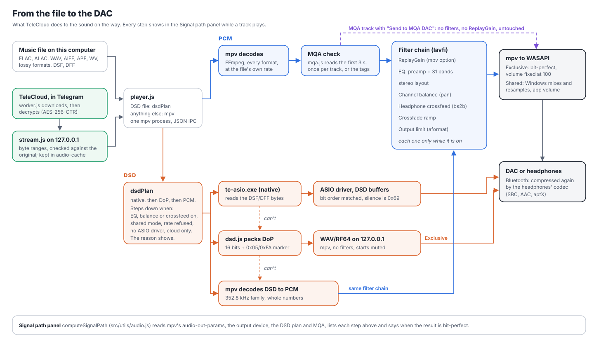

# TeleCloud: technical documentation

For what the app does and how to use it, see the [main README](../README.md). This file is for people working on the code.

TeleCloud is a hi-res music player for Windows, built with Electron and React. mpv plays the audio, and the user's own Telegram account stores the backup. No server belongs to the project.

## Tech stack

| Part | Used for |
|---|---|
| Electron | Desktop shell, main process, background processes |
| React and Vite | Interface in `src/` |
| mpv (`mpv.exe`, included in the repo) | Playback, EQ filters, spectrum decoding |
| `better-sqlite3` | Library, play history and TeleCloud tables |
| `music-metadata` | Reading tags and cover art |
| `node-taglib-sharp` | Writing tags and cover art |
| `telegram` (GramJS) | Telegram access, in its own process |
| `electron-updater` | Updates from GitHub Releases |
| `electron-store` | Encrypted TeleCloud credentials and options |
| `tc-asio.exe` (`native/asio`, C++) | Native DSD through the DAC's ASIO driver |

## Getting started

You need Node.js (currently developed on v24) and Windows 10 or 11, 64-bit.

```bash
git clone https://github.com/MinhHaiDeveloper/telecloud.git
cd telecloud
npm install
npm run dev
```

`npm run dev` starts Vite on port 3000 and opens Electron on it.

Every user enters their own Telegram app keys in the app, so no keys are needed to build it. Last.fm is the exception: it reads the app's key from `electron/lastfm-key.json`, or from `LASTFM_API_KEY` and `LASTFM_API_SECRET`. That file is not in git. Without it the app works, but Last.fm stays unavailable.

## Project layout

```
electron/            main process
  telecloud/         Telegram backup, streaming, restore
src/
  components/        React components
  hooks/             useEq, useSlidingIndicator
  utils/             logic with no interface
  styles/            tokens.css, app.css, components.css
scripts/release.js   build one channel into beta/ or release/
```

### Main process (`electron/`)

| File | Responsibility |
|---|---|
| `main.js` | Startup, window, `media://` protocol, folder watching |
| `preload.js` | The only bridge to the page, with allowlists of channels |
| `paths.js` | Decides which paths may be read, played, written or deleted |
| `database.js` | `music_files` table, migrations |
| `music.js` | Scanning, syncing with the database, JSON stores |
| `tags.js`, `tagPool.js`, `tagWorker.js` | Reading tags on worker threads |
| `tagEdit.js` | Writing tags from Edit info |
| `inferTags.js` | Filling in missing tags from the file name and folders |
| `fileWrite.js` | Plain-language write errors, writing to read-only files on request |
| `player.js` | mpv over JSON IPC, filter chain, crossfade, output devices, DSD plan |
| `dsd.js` | Reading DSF/DFF and packing DoP |
| `asio.js` | Runs `tc-asio.exe` for native DSD |
| `mqa.js` | Finding MQA in the audio and the tags |
| `tagFile.js` | Opening tags, including DSF (its ID3v2 tag at the end) |
| `artistImages.js` | Artist picture sources, saving, GIFs |
| `tray.js` | Close to the tray, one copy of the app |
| `covers.js` | Finding and caching cover art |
| `coverSearch.js` | Online cover sources, saving covers |
| `lyrics.js` | Lyrics sources and saving |
| `stats.js` | Play history, play counts, Dashboard data |
| `lastfm.js` | Scrobbling and artist biographies |
| `discord.js` | Discord status over its local pipe |
| `remote.js` | TeleCloud Remote: the local web server other devices control the app through |
| `autoeq.js` | Headphone measurements and target curves |
| `spectrum.js`, `spectrumCore.js` | Spectrogram and lossless check |
| `watcher.js` | Native folder watching, followed by a normal refresh |
| `updater.js` | Update checks and installation |
| `logger.js`, `logExport.js` | Log files and the log export |
| `credentialManager.js` | Encrypting Telegram credentials with Windows DPAPI |

### TeleCloud (`electron/telecloud/`)

| File | Responsibility |
|---|---|
| `service.js` | Sign-in, backup queue, cache, restore, storages, index |
| `store.js` | TeleCloud tables |
| `workerClient.js` | Starts the worker and passes calls to it |
| `worker.js` | Everything that talks to Telegram, in a separate process |
| `stream.js` | Local HTTP server that streams cloud tracks to mpv |
| `crypto.js` | Client-side encryption |
| `caption.js` | The text stored with each message in Telegram |

### Interface (`src/`)

`App.jsx` holds the shared state: library, playback, queue, navigation. Views get what they need as props or through the `SongActions` context in `components/songActions.js`.

| File | Responsibility |
|---|---|
| `utils/albums.js` | Which tracks form an album and who owns it. Every page uses it |
| `utils/audio.js` | Formatting, quality labels, signal path, duplicates, cover addresses |
| `utils/autoEqMath.js` | Filter responses, AutoEQ, Squiglink and Audacity formats |
| `utils/appearance.js` | Full-screen look, saved in `localStorage` |
| `utils/whatsNew.js` | Release notes shown in the app |
| `utils/badges.js` | Text for the Source, Quality and Plays help |
| `components/ui.jsx` | Shared controls, dialogs, `useDetailScroll` |
| `remote/` | The Remote page other devices open (`remote.html` entry), and `hostQuery.js`, which answers its library questions inside the app |

## How it works

### Security boundary

The page runs with `contextIsolation`, `sandbox` and no `nodeIntegration`. It reaches the main process only through `window.ipcRenderer` in `preload.js`.

- A new IPC channel must be added to `INVOKE_CHANNELS` or `EVENT_CHANNELS`, otherwise the call is refused.
- Any handler that takes a path from the page must check it with `paths.js`.

### Library

`syncLibrary` in `music.js` compares the music folders with the database by path, size and modified time. Only new or changed files are read, on worker threads, and the results reach the page in batches.

A backed-up track whose file disappears becomes cloud-only. Tracks in a folder that can't be read, such as an unplugged drive, are kept. A backed-up file whose bytes change is uploaded again.

Older libraries gain `album_artist` from `backfillAlbumArtists`, which runs once in the background and changes only that column.

### Albums and artists

`Various Artists` and `Unknown Artist` are labels, not artists (`artistLabel`). They are pinned first on the Artists page, hold the albums nobody is named on, show a grid of those covers, and never get a search or a bio.

`albumIndex` in `utils/albums.js` groups tracks like this:

- The same name and overlapping album artists make one album, however many guests the tracks have.
- The same name with different album artists makes separate albums.
- Without an album artist tag, tracks in one folder stay together, and across folders they join when the main artist matches.

An album without the tag belongs to an artist who is on more than half of its tracks. Otherwise it shows as Various Artists.

`inferTags.js` fills in missing title, artist, album, track, disc and year when a row goes to the page. These values are for display and are never written to the file. The `metadata.inferred` field lists which ones they are.

### Playback

`player.js` runs one mpv process and controls it over a named pipe. Exclusive WASAPI gives bit-perfect output, with volume fixed at 100.



The filter chain is built in `chainSpec`, in this order, and each part is there only while it is on:

| Label | Filter | From |
|---|---|---|
| `@pre`, `@b0`... | `volume`, then one `equalizer` / shelf per band | EQ. Bands are changed live with `af-command`, so dragging doesn't rebuild the chain |
| `@stereo` | `aformat=channel_layouts=stereo` | Balance or crossfeed |
| `@bal` | `pan`, the quieter side multiplied down | Channel balance |
| `@xfeed` | `bs2b` (`jmeier`, `cmoy`, `default`) | Headphone crossfeed |
| `@xf` | `volume`, ramped for a crossfade | Crossfade |
| `@fmt` | `aformat` | Output limit |

ReplayGain is mpv's own option, not a filter. `dspWhy` names the first of EQ, balance or crossfeed that is on: native DSD and DoP need none of them, so they fall back to PCM with that reason.

Some tracks get their own options for one playlist entry (`loadfile` options), so the chain set for everything else comes back by itself at the next track: DoP (`af=`, starts muted) and MQA sent to an MQA DAC (`af=`, `replaygain=no`). A chain change during such a track waits for the next one.

Extra copies of a track are removed from the queue when playback starts, in `playMusic`.

**EQ per output.** With the option on, `useEq` keeps one profile per device id in `profiles` in `eq.json`. The top-level values stay as the shared EQ. A device seen for the first time starts from what is on.

**ReplayGain Auto.** The renderer decides: album gain when shuffle is off and a neighbour in the queue belongs to the same album, otherwise track gain. It tells `player.js` through `player:replaygain-auto`.

### Themes

A theme is a block of CSS tokens on `[data-theme]`: Dark and Vanilla in `styles/tokens.css`, the others in `styles/themes.css`. `utils/themes.js` lists them. Adding one takes a token block and a line in that list. Text on the accent colour uses `--on-accent`, never a fixed white.

**Follow the cover.** `useCoverAccent` overrides the accent tokens on the root element with a colour from the cover playing. `utils/coverAccent.js` picks the main hue, then moves its lightness until it reads on the theme's page and card colours. Covers without a clear colour keep the theme's accent.

### DSD

mpv can't send DSD to a DAC. It decodes it to floating-point PCM at 1/8 of the DSD rate (2822.4 kHz for DSD512), so `dsdOptions` in `player.js` asks for 352.8 kHz whole-number PCM instead, or the highest rate of that family under the output limit.

**DoP** (Settings > Playback > DSD playback) packs 16 DSD bits under an alternating 0x05/0xFA marker into each 24-bit sample (`dsd.js`, DSF and plain DFF). The samples are served from 127.0.0.1 as a WAV (RF64 past 4 GB) and mpv reads them with no filters. Not raw PCM: mpv's raw reader stops at 384 kHz, and DSD256 as DoP is 705.6 kHz. It is used only in WASAPI Exclusive with the EQ off and under the chosen highest rate. The file starts muted, and `judgeDop` unmutes it only when mpv opened the device at exactly the DoP rate as whole numbers. Otherwise the rate is remembered as refused for that device, and the track goes on as PCM from the same moment. Turning the EQ on or switching to shared mode does the same.

**Native DSD** goes through `native/asio/tc-asio.exe`, a small C++ program on the Steinberg ASIO SDK (used under its GPL-3.0 option; the SDK files are in `native/asio/sdk`). Build it with `native\asio\build.cmd` before packaging; electron-builder copies it next to mpv.exe. It reads the DSF/DFF itself and copies the bytes to the driver's DSD buffers, reversing the bit order when the driver wants the other one, so nothing changes on the way. Pauses and gaps send DSD silence (0x69), never zeros. A gapless join works when the next file has the same rate and channels.

`asio.js` runs the helper; `player.js` tries native first when it is chosen. mpv is closed while ASIO has the DAC and started again for the next PCM file. A DAC's WASAPI output disappears for about a second while its driver leaves ASIO (measured on a Topping DX1 II), so `waitForOutput` waits for it to be listed again. If mpv still can't open the output, `retryOutput` loads the track again every 0.5 s for up to 6 s before it reports an error. A driver that can't play the file (no DSD, not that rate, busy, an error while playing) hands the track to mpv at the same moment: DoP if it can, else PCM. The reason shows in the signal path and the log. The EQ can't touch native DSD, so turning it on does the same. "TeleCloud test output" (only with TC_ASIO_TEST_OUT set) plays in real time into files, so tests check every byte without hardware.

ASIO is a trademark of Steinberg Media Technologies GmbH.

### Balance, crossfeed and MQA

Channel balance and headphone crossfeed are filters in the same chain as the EQ (`pan` and `bs2b`), so like the EQ they send native DSD and DoP back to PCM, with the reason in the signal path. Balance only turns one side down, never the other up.

`mqa.js` finds MQA the way MQA_identifier does (Apache-2.0): the first seconds are decoded with mpv as 32-bit samples and the XOR of the two channels is searched for the sync word, which also gives the original rate and MQA Studio. Tags (`MQAENCODER`, `ORIGINALSAMPLERATE`) count at the scan; the audio is read the first time a track plays, or for the whole library from Settings. TeleCloud does not unfold MQA. "Send to MQA DAC" plays MQA tracks with no filters and no ReplayGain (per-file `af=` and `replaygain=no`), so the DAC gets the bits it needs.

### Covers

`media://<encoded path>[?r=revision]` serves artwork for library tracks. Lookup goes through `artFor` in `main.js`:

- **File on this computer:** embedded art, then a picture in the folder such as `cover.jpg`.
- **Cloud-only track:** the stored TeleCloud cover first, then the cached copy's art.

Results are cached in `cover-cache` at up to 600 px. After a save, `bumpCovers` gives the affected tracks a new address, so the browser doesn't keep showing the old picture.

Saving goes to `cover.jpg`, to the tags, or both. If a folder holds another album, the cover goes to the tags instead. Embedded art has priority over `cover.jpg`, so replacing a cover also replaces the embedded one. Files that change this way are backed up again.

### Artist pictures

`artistImages.js` works like the cover search: an ordered list of sources and results to pick from. Last.fm's API only returns a placeholder, so that source reads the artist's public page. Sources: this computer, Last.fm, Deezer and TheAudioDB (its public free key; its terms ask for credit, which the source badge on each result gives). A saved picture goes into the tags of the artist's own tracks as an `Artist` picture (ID3 type 8), beside the front cover. A copy in `artist-images` lets the pages show it without reading the files, and is the only copy for cloud-only tracks. A track counts as an artist's own only if it belongs to them alone, so a picture is never written into a shared track. M4A and other formats without picture labels are skipped, because the picture would become a second cover there. `Various Artists` and `Unknown Artist` are never searched.

Apple's search API has no artist pictures, so that source reads the preview picture on the artist's public page. MusicBrainz has none of its own either: it links a photo on Wikimedia Commons, directly or through Wikidata, and is limited to one request a second.

YouTube is a separate tab in the dialog, so it is asked only when that tab is opened: a search costs 100 of a key's 10,000 daily units. The key comes from Settings or from `electron/youtube-key.json` (not in git, packed with the app). Answers are kept for 30 days in `youtube-artists.json`.

A GIF stays animated only inside TeleCloud: the original is kept beside the still copy, shown on the artist's own page, and goes into the chat with a cover caption whose key starts with `g`. The index lists it under `artists`, which is how a new computer gets it back on Restore. Tags get the first frame as a JPG.

DSF files can hold pictures and tags too. node-taglib-sharp doesn't open them, so `tagFile.js` reads and writes the ID3v2 tag at the end of the file and leaves the audio alone.

### TeleCloud

Telegram work runs in a `utilityProcess` (`worker.js`), so the interface stays smooth. The worker receives `{ id, method, params }` and answers with a result or an error; progress arrives as events.

**Upload.** Files move in 512 KB parts and are never held whole in memory. The same audio already in a storage is linked rather than uploaded twice.

**Encryption.** There is one random master key per user, shown as a recovery key. Audio uses AES-256-CTR, so any byte range can be decrypted on its own. Captions use AES-256-GCM, so a wrong key or tampering is detected.

**Streaming.** `stream.js` serves each cloud track from `127.0.0.1` at a secret address, and mpv reads it with byte-range requests. Seeking works, and the bytes are exactly the uploaded file. Blocks are cached on disk and become a normal cached file once complete and verified.

**Index.** The manifest (`library.tcm`) holds tags, lyrics and cover references. It is pinned in the chat and rewritten after changes. Restore on another computer reads it, and falls back to the captions if it can't.

**Check backup.** `checkBackup` lists each chat and compares it with the library, `cloud_index`, the manifest and the covers. It only compares message ids and sizes, so damage inside a file of the right size isn't seen. `repairBackup` queues tracks still on this computer again, uploads lost covers from the local copy, and saves the index. It deletes a wrong-size copy from the chat first, otherwise the same hash would link back to it.

**Caption prefixes in Telegram:** `tc1:` for audio, `tcm1:` for the manifest, `tcc1:` for covers. They also tell TeleCloud's messages apart from the user's own.

### Discord

`discord.js` talks to the Discord desktop app over its local pipe, using the application ID in that file. It is off by default. The cover is a public picture from the online sources, otherwise the `telecloud` art asset. The small picture is the first artist's, from a picture chosen online or the artist sources, and its hover text is that artist's name. While nothing is loaded, the status shows the last track played (`discord-last.json`). A **Get TeleCloud** button links to the website unless turned off. Updates go out at most once every 4 seconds. The app never uploads files for this.

### Remote

`remote.js` runs a plain HTTP server only while Settings > Remote is on, on a new random port each start. The page is `remote.html` (its own Vite entry, built into `dist/`; under `npm run dev` it comes from Vite, limited to the files the page needs).

- **Pairing.** The QR code holds `http://<address>:<port>/#k=<key>`. The fragment never reaches a server log; the page posts the key to `/api/pair` and gets an HttpOnly, SameSite=Strict cookie. Tokens are kept hashed. **New key** signs every device out; a device can be removed or set to View only (its commands get 403).
- **State** goes out as Server-Sent Events (`/api/events`), sent by the window when something changes and every 5 seconds while playing. **Commands** are `POST /api/cmd` with an `X-TeleCloud: 1` header (a page on another site can't send it), at most 15 a second per device, checked one by one, then handed to the window as `remote:command`, so the queue, history, Last.fm and Discord behave as for a click on this computer.
- **Library lists** are `POST /api/browse`: main asks the window (`remote:query`), `src/remote/hostQuery.js` answers from what the app holds, a page of 60 at a time, and main rebuilds the answer key by key. `kind: 'lyrics'` returns the lines of the track that plays (from the tags, or just found online), with times when synced; the state's `lyrics` number changes when they do, so the page asks again. The state also carries the signal path steps, label, value and state only.
- **Keep awake.** The window reports playing and paused (`power:playing`); with the option on, main holds a `prevent-app-suspension` power blocker while music plays. Settings also shows the MAC and broadcast address of the chosen adapter for Wake-on-LAN.
- **Never sent:** audio, file paths, folders, settings, Telegram. Tracks are known by an opaque id (part of a SHA-1 of the path); covers are served by that id through `covers.artFor`, the same lookup as the app's `media://` covers (so cloud-only tracks get their TeleCloud cover), resized to 512 px (WebP and GIF as they are). A track only in TeleCloud carries `where: 'cloud' | 'cached'`, and a playback error on the computer goes out as `notice`. Artists carry `pic`, an opaque id for `/api/artist/<pic>` (`artistImages.pictureFor`, or `?motion=1` for the GIF); the page falls back to an album cover.
- **Layouts.** `layoutOf()` in `RemoteApp.jsx` picks phone, tablet or desktop by width, plus three for foldables: `fold` (Android with a touch screen whose own shape, `screen.width` by `screen.height`, is 0.72 or squarer and at most 1300 px long: the inner screens, where Chrome sends a tablet user agent; also an Android "Mobile" browser 600 px wide or more, or two side-by-side viewport segments; two equal pages around the crease), `flex` (two viewport segments one above the other, Flex Mode: the top segment's height and the hinge come from `window.viewport.segments`) and `cover` (a touch screen narrower than 0.44, 21:9 and taller: tabs at the bottom). The screen's shape is used, not the page's, because Chrome's bars take part of the page. Tests emulate the screens with `Emulation.setDeviceMetricsOverride` (screen size, page size and a `displayFeature` for the hinge), sent after a page has loaded.
- **Pairing again.** Opening the link with the key in a browser that is already paired keeps the same device (no second entry).
- **Changes on the computer.** The state carries two counters: `art` changes on `telecloud:covers` and `telecloud:artists` (every picture address gets `?r=<art>`, so phones don't keep an old picture), and `lib` changes with the library, favourites or playlists (the page drops its kept lists and asks again for the page it shows, in place).

### Logs

`logger.js` is started first in `main.js` and records everything sent to `console`, plus window errors, crashes, the worker, scan threads and mpv warnings.

- Files are in `logs/YYYY-MM-DD.log`. Limits: 14 days, 50 MB in total, 15 MB per day. Repeated lines are folded.
- `redact` removes secrets before writing, and `logExport.js` runs it again on export. Credentials are registered with `addSecrets` when they are loaded.
- The export also hides music names unless the user includes them. `system.txt` lists settings only from the `SAFE_SETTINGS` allowlist.

When adding a log line, don't log credentials, captions or track names. Paths are fine, because the export hides them.

## Data on disk

Everything is in `%APPDATA%\telecloud`.

| Location | Contents |
|---|---|
| `music-library.db` | SQLite database |
| `settings.json` and other stores in `music.js` | Settings, playlists, favourites |
| `lyrics-settings.json`, `cover-settings.json`, `discord-settings.json`, `artist-picture-settings.json` | Options of each feature |
| `artist-images/` | Artist pictures shown in the app, GIFs and `gifs.json` |
| `youtube-artists.json` | YouTube answers, kept 30 days |
| `discord-last.json` | The last track played, for the Discord status |
| `remote-settings.json` | Remote: on or off, pairing key, display name, paired devices (tokens stored hashed) |
| `telecloud-sync.json` | Telegram credentials and options |
| `lastfm.json` | Last.fm account, with the session key encrypted |
| `audio-cache/` | Downloaded cloud tracks |
| `cover-cache/` | Cover cache and TeleCloud covers |
| `telecloud/` | Cached manifests |
| `logs/` | Log files |

Database tables:

| Table | Holds |
|---|---|
| `music_files` | One row per track: tags, `album_artist`, audio details, `storage_type` (`local`, `cloud`, `both`), `telegram_message_id`, `telegram_channel_id`, `cache_path`, `cloud_checksum`, `cloud_cover`, `mqa` (null not known yet, 0 no, 1 MQA, 2 MQA Studio), `mqa_rate` |
| `plays` | Listening history. Title, artist and album are kept with each play |
| `storages` | Telegram chats used as storage, up to 5 |
| `cloud_index` | One row per file message: checksum, size, IV, track info |
| `upload_queue` | Backups waiting, running or failed; survives restarts |
| `cloud_covers` | Which cover is in which storage |
| `sync_state` | Older per-file sync details |

A cloud-only track restored on another computer has a path like `tc://<chat>/<message>`.

## Building

```bash
npm run build:beta
```

```bash
npm run build:release
```

`build:beta` needs a pre-release version such as `1.0.0-beta.12` in `package.json`, and `build:release` needs a plain one. Each version builds once: the script stops if its folder already exists. The result goes to `beta/telecloud-<version>/` or `release/telecloud-<version>/`.

If `build:beta` fails with `EPERM` on `win-unpacked.tmp`, another program is holding the folder. The cause hasn't been pinned down. Building outside the project works:

```bash
npx vite build
```

```bash
npx electron-builder --win --publish never "-c.directories.output=C:\some\other\folder"
```

Then copy the installer, its `.blockmap` and `latest.yml` to the `beta/` folder yourself.

### Releasing

1. Set the new version in `package.json`, and add its notes at the top of `RELEASES` in `src/utils/whatsNew.js`.
2. Build, then commit and **push before creating the release**, so the tag points at the right commit.
3. Create the GitHub release with the tag `v<version>`, and tick pre-release for a beta.
4. Upload the `.exe`, the `.blockmap` and `latest.yml`. Auto-update needs all three.

Beta installs also receive pre-releases; stable installs only receive releases.

`npm run build:beta` makes **TeleCloud Beta**: its own name, a teal-to-violet icon (`public/icon-beta.*`), `TeleCloud-Beta-Setup-<version>.exe`, and a Beta tag in the app and on remotes (any version with a `-`). It has the same app id as TeleCloud, so installing one replaces the other, and both keep the one library in `%APPDATA%	elecloud`. Stable releases come from their own branch (`release/1.0` for 1.0.x); betas from `main`, numbered above the last release (1.1.0-beta.N after 1.0.0).

## Testing hooks

There is no test suite in the repo. These environment variables let a script run the real app without touching real devices or services:

| Variable | Effect |
|---|---|
| `TELECLOUD_MPV_AO` | Audio output for mpv, for example `null` for silence |
| `TELECLOUD_DISCORD_PIPE` | Pipe to use instead of the real Discord |
| `TELECLOUD_REMOTE_HOST` | Address the remote listens on, for example `127.0.0.1` so tests get no firewall prompt |
| `TELECLOUD_REMOTE_DEV_SERVER` | In development, where the remote page comes from (default `http://localhost:3000`); `off` serves `dist/` |
| `TC_ASIO_TEST_OUT` | Adds "TeleCloud test output", an ASIO stand-in that writes the DSD it gets to files |
| `TELECLOUD_FAKE_CLIENT` | Module to use instead of the real Telegram client |
| `TELECLOUD_IN_PROCESS` | Runs the TeleCloud worker in the same process |
| `TELECLOUD_MANIFEST_EVERY` | How many tracks between index saves during a backup |
| `LASTFM_API_URL`, `LASTFM_AUTH_URL` | Addresses to use instead of Last.fm |

## License

[GPL-3.0](../LICENSE)
